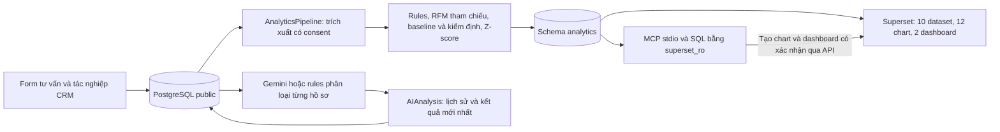
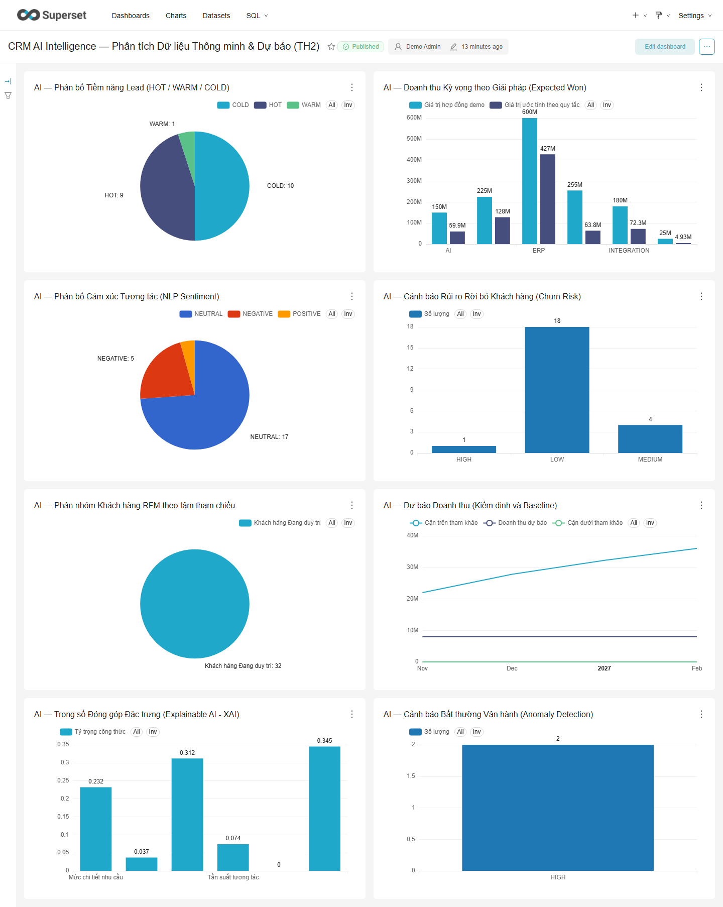

# Báo cáo kỹ thuật TH2 — AI Analytics và Apache Superset

Ngày đối chiếu mã nguồn và kiểm thử: **15/10/2026**. Ứng dụng là CRM B2B cho doanh nghiệp cung cấp giải pháp chuyển đổi số; không phải ERP kế toán/kho/nhân sự.

## 1. Kiến trúc và luồng dữ liệu



CRM Docker dùng PostgreSQL 16; môi trường local có thể dùng SQLite. Metadata Superset nằm ở database riêng. Superset đọc bốn view nghiệp vụ (`customer_monthly`, `lead_pipeline`, `care_task_summary`, `revenue_transactions`) và sáu bảng kết quả (`ai_lead_predictions`, `ai_sentiment_churn`, `ai_customer_rfm_segments`, `ai_revenue_forecast`, `ai_anomaly_alerts`, `ai_explainability_summary`).

Pipeline chạy theo yêu cầu bằng command hoặc nút POST có quyền `analyze_customer`. Sáu bảng được cập nhật trong transaction; Superset không có quyền ghi dữ liệu CRM. Sau thay đổi CRM, cần chạy lại pipeline để dashboard đọc kết quả mới. Chưa có CDC, lịch chạy nền hoặc bảo đảm cập nhật thời gian thực.

## 2. AI và các phương pháp thực tế

| Thành phần | Hiện thực | Giới hạn |
|---|---|---|
| Phân loại hồ sơ | Gemini trả JSON phân khúc/điểm/nhận định/đề xuất; fallback rules | LLM có thể sai; nhân viên rà soát, không tự gửi thư |
| Lead scoring | Công thức sigmoid với trọng số quy định; HOT/WARM/COLD, giá trị hợp đồng demo | Chưa học từ nhãn kết quả bán; không phải xác suất đã hiệu chuẩn |
| Sentiment/churn | Lexicon tiếng Việt, cụm dài, phủ định, độ trễ liên hệ và việc chưa xử lý | Hạn chế với mỉa mai, phủ định phức tạp; cảnh báo theo tương tác |
| RFM | Chuẩn hóa Recency/Frequency/Monetary rồi gán tâm tham chiếu cố định | Không huấn luyện K-Means, không có Silhouette thực nghiệm |
| Dự báo | Baseline tháng cuối; tuyến tính/trung bình 3 tháng chỉ khi đủ 18 tháng và cải thiện kiểm định quá khứ; tối thiểu 3 tháng để hiển thị | Không phải Prophet/ARIMA; dải sai số chưa hiệu chuẩn độ bao phủ |
| Giải thích | Tổng hợp đóng góp thành phần công thức chấm điểm | Không phải SHAP hoặc suy luận nhân quả |
| Bất thường | Lead bị ngâm theo lần liên hệ gần nhất; Z-score giao dịch | Ngưỡng là giả định demo, cần hiệu chỉnh bằng dữ liệu thật |

Gemini tư vấn giữ ngữ cảnh nhiều lượt và có timeout/fallback; prompt yêu cầu không hứa giá, thời gian, gói dịch vụ hay SLA khi chưa có căn cứ. LLM vẫn có thể không tuân thủ, cần rà soát nội dung. Email nháp có bước người dùng xác nhận đã gửi bên ngoài; tạo nháp không gửi email.

## 3. Consent và phân quyền

Lead và từng phản hồi lưu consent AI riêng. Migration `0009` bổ sung consent nullable cho `Interaction`, tránh dùng nhầm hội thoại chưa được phép. Hồ sơ công khai chỉ đưa nhu cầu/phản hồi/chat có consent vào phân tích; chat cũ chưa rõ consent được loại. Prompt hồ sơ công khai lược bỏ trường tên/email/điện thoại của hồ sơ; người nhập vẫn cần tránh đưa dữ liệu nhạy cảm trực tiếp vào nội dung tự do.

MCP SQL mở connection riêng bằng `superset_ro`, chỉ nhận một SELECT, đặt transaction read-only và statement timeout. Kiểm tra thực tế xác nhận đọc được analytics và bị từ chối khi đọc `public.crm_customer`. Form follow-up dùng token hash, hạn dùng, một lần trả lời, thu hồi và `strict-origin` để giữ kiểm tra CSRF nhưng không gửi đường dẫn token qua Referer.

## 4. Superset và MCP

`superset/bootstrap_superset.py` dùng REST API để đăng ký 10 dataset, tạo/cập nhật 12 chart và hai dashboard: `crm-analytics-dashboard`, `crm-ai-intelligence-dashboard`. Chart AI dùng chung giữ đủ liên kết với cả hai dashboard. Tên phương pháp phản ánh code thực tế; bootstrap nhận diện tên cũ khi đổi tên để không tạo bản trùng.

MCP chạy bằng `python manage.py run_superset_mcp`, hỗ trợ initialize, notification, ping và tools qua stdio. Bảy tool gồm `superset_list_dashboards`, `superset_list_datasets`, `superset_query_ai_insights`, `superset_execute_sql`, `superset_trigger_pipeline`, `superset_create_chart`, `superset_create_dashboard`. Các thao tác thay đổi yêu cầu `confirm=true`; chart chỉ dùng cột/phép tổng hợp đã kiểm tra trên dataset CRM analytics. Dashboard mới mặc định nháp, giữ liên kết chart cũ. Bootstrap REST tiếp tục dựng cấu hình chuẩn; MCP đã thực hiện tạo chart/dashboard trực tiếp qua tool, không chỉ liệt kê dữ liệu. Chưa có HTTP MCP.

Bootstrap quản lý 12 chart và hai dashboard có 8 chart mỗi dashboard (có chart dùng chung). Các chart/dashboard nháp tạo thêm qua MCP và kết quả truy vấn/render đều được ghi ở [superset-live.json](validation/superset-live.json), [MCP stdio](validation/mcp-authoring-live.json) và [thư viện đủ năm loại biểu đồ](validation/mcp-authoring-gallery.json).



## 5. Đánh giá có thể tái lập

Lệnh `evaluate_ai_quality` tính kết quả từ từng tình huống và rolling-origin backtest, không in số liệu ghi cứng. Nguồn là bộ minh họa do nhóm biên soạn, có dùng để sửa prompt/rules, không phải tập kiểm định độc lập hoặc dữ liệu khách hàng thật.

- Lượt chạy lại mới nhất: 7/7 nhãn phù hợp kỳ vọng, gồm 6 Gemini và 1 rules fallback; hồ sơ thứ tám không consent không được phân tích. Tỷ lệ fallback không được tính thành thành công của Gemini.
- Rules: cùng khớp 7/7 nhãn; nhận diện nhóm giải pháp 8/8 trên bộ nhỏ.
- Sentiment: sau sửa phủ định tu từ, 20/20 câu khớp nhãn của bộ phát triển; chưa phải độ chính xác trên dữ liệu độc lập.
- Dự báo: MAE trên 4 tháng demo là 3.500.000 VNĐ khi chọn baseline, so với hồi quy cũ 4.431.953 VNĐ. Chưa có bằng chứng vượt baseline trong tương lai hoặc đủ cơ sở dùng cho quyết định doanh thu.
- Không công bố ROC-AUC chuyển đổi, Silhouette, SHAP hoặc coverage 95,4% khi chưa có phép đo tương ứng.

Chi tiết ca sai ban đầu xem [báo cáo E2E/AI](kiem-thu-e2e-va-danh-gia-ai.md); trạng thái sau khắc phục xem [hoàn thiện TH2](hoan-thien-th2.md). Kết quả test mới: [completion-test-results.json](validation/completion-test-results.json).

### 5.1. Phạm vi đánh giá và nguồn dữ liệu

Phần bổ sung ngày **18/10/2026** làm rõ yêu cầu số 5 của đề bài. Các số đo dưới đây lấy từ minh chứng ngày 15/10/2026 đã lưu trong repository, không phải kết quả chạy Gemini mới ngày 18/10.

| Nguồn | Đơn vị quan sát và nhãn | Mục đích và hạn chế |
|---|---|---|
| `crm/data/consultation_scenarios.json` | 8 tình huống nhu cầu B2B; 7 có consent và nhãn phân khúc; 20 câu có nhãn sentiment | Kiểm tra phân khúc, nhóm giải pháp và cảm xúc; là dữ liệu do nhóm biên soạn và đã dùng trong phát triển |
| `AIAnalysis` của email `scenario.*@consultation.test` | Kết quả mới nhất theo khách hàng, gồm nhãn, điểm, provider và nhận định | Đối chiếu kết quả lưu thực tế; cần seed/phân tích trước; thiếu kết quả được ghi `not_run` |
| `SalesRecord` có trạng thái `WON` | Tổng `amount` theo tháng `closed_at`, đơn vị VNĐ | Backtest doanh thu; tháng trống giữa tháng đầu/cuối có giao dịch được điền 0; chưa có cơ chế phân biệt thiếu nhập liệu với doanh thu thực sự bằng 0 |
| JSON và ảnh Superset trong `docs/validation/` | Truy vấn, kết quả tạo chart/dashboard và ảnh render | Chứng minh tích hợp BI hoạt động; không chứng minh độ chính xác của mô hình |

Không trộn 8 tình huống, 7 hồ sơ được phép phân tích và 20 câu sentiment thành một mẫu số. Hồ sơ không consent được kiểm tra như một ràng buộc nghiệp vụ, không gán là dự đoán sai hoặc tự gọi AI để đủ mẫu.

### 5.2. Truy vết dữ liệu thô đến chỉ số dashboard

| Đầu vào → xử lý | Đầu ra analytics / mức chi tiết | Cách đọc trên Superset và hành động nghiệp vụ |
|---|---|---|
| Lead có consent, chưa hoàn tất; điểm hồ sơ, số tương tác được phép, thông tin liên hệ, độ dài nhu cầu, thời gian gửi follow-up → sigmoid | `ai_lead_predictions`, một dòng/lead | Đếm HOT/WARM/COLD, tổng giá trị cơ hội quy đổi; nhân viên mở hồ sơ xác minh trước khi tạo việc. `win_probability` là tên trường cũ của điểm heuristic, chưa là xác suất chốt |
| Nội dung tương tác được phép, độ trễ liên hệ, số việc chưa xử lý → lexicon và rules churn | `ai_sentiment_churn`, một dòng/tương tác | Đếm nhãn cảm xúc/rủi ro; một khách có thể có nhiều dòng nên không gọi số dòng HIGH là số khách duy nhất có nguy cơ |
| Lần tương tác được phép gần nhất, số lần tương tác, `total_spent` → RFM tham chiếu | `ai_customer_rfm_segments`, một dòng/khách | Phân bố nhóm chăm sóc; Frequency hiện là số tương tác, không phải số đơn mua; Recency mặc định 60 ngày nếu không có tương tác |
| Giao dịch WON → tổng doanh thu tháng → chọn baseline hoặc mô hình đủ điều kiện | `ai_revenue_forecast`, một dòng/tháng dự báo, mặc định 4 tháng | Xem xu hướng và dải sai số tham khảo; không cộng giá trị cơ hội heuristic vào doanh thu đã chốt |
| Lead bị bỏ quên và độ lệch giá trị giao dịch → ngưỡng/rules/Z-score | `ai_anomaly_alerts`, một dòng/cảnh báo | Danh sách cần kiểm tra; cảnh báo giao dịch lớn không đồng nghĩa gian lận |
| Các thành phần công thức của lead đang được phân tích → tổng trị tuyệt đối và chuẩn hóa | `ai_explainability_summary`, một dòng/đặc trưng | So sánh đóng góp tổng hợp vào công thức; không diễn giải thành nguyên nhân mua hàng hoặc SHAP của từng khách |

Đối chiếu ở [pipeline.py](../crm/analytics/pipeline.py), [ai_engine.py](../crm/analytics/ai_engine.py), [service phân tích hồ sơ](../crm/services/ai_service.py) và [cấu hình Superset](../superset/bootstrap_superset.py). Phân loại hồ sơ Gemini/rules và sáu luồng analytics là hai bước riêng: lưu phân tích hồ sơ không tự làm mới toàn bộ bảng Superset.

Luồng vận hành là **ghi CRM → nhân viên chạy phân tích hồ sơ nếu cần → xác nhận làm mới analytics → transaction ghi sáu bảng → refresh Superset → kiểm tra hồ sơ và xác nhận hành động**. Transaction bảo vệ bước ghi; các truy vấn trích xuất trước đó chưa nằm trong cùng một snapshot database nên chưa bảo đảm ảnh chụp nhất quán nếu CRM đang được sửa đồng thời. Các bảng kết quả được thay nội dung mỗi lần chạy, chưa lưu lịch sử từng batch/model version; khi đánh giá cần giữ JSON, mốc thời gian và commit tương ứng.

### 5.3. Quy trình đo và công thức

Mã đo nằm trong [evaluation.py](../crm/analytics/evaluation.py), được gọi qua command `evaluate_ai_quality`.

1. Cố định phiên bản bộ tình huống; ghi commit (`git rev-parse HEAD`), thời điểm, provider yêu cầu và nguồn database. Không sửa nhãn sau khi xem dự đoán của lượt đo được công bố.
2. Chạy rules trên bộ tình huống. Với `--provider stored`, đọc kết quả mới nhất trong database; lệnh này không gọi Gemini. Tên file chứa “gemini” không đủ chứng minh mọi dòng đều từ Gemini: phải đọc `provider` từng ca.
3. Đếm khớp nhãn phân khúc và nhóm giải pháp. Với sentiment, lập TP/FP/FN cho từng lớp POSITIVE, NEUTRAL, NEGATIVE rồi tính Accuracy và Macro-F1.
4. Với doanh thu, giữ tối thiểu 3 tháng đầu làm lịch sử; tối đa 4 tháng cuối được dự báo lần lượt bằng tiền tố quá khứ. Ở mỗi mốc chỉ dùng dữ liệu trước tháng cần dự báo, so cùng tháng thực tế cho mô hình chọn, baseline tháng cuối và tuyến tính.
5. Đọc từng ca sai, kiểm tra fallback/thiếu kết quả và lưu cả kết quả tốt lẫn lỗi. Backend/E2E đạt chỉ xác nhận hành vi phần mềm, không thay thế kiểm định AI độc lập.

Các công thức dùng để đọc báo cáo:

- `Accuracy = số nhãn khớp / tổng mẫu được đánh giá`.
- `F1_lớp = 2TP / (2TP + FP + FN)`; khi mẫu số bằng 0, code hiện ghi 0. `Macro-F1` là trung bình F1 của cả ba lớp sentiment.
- `MAE = tổng |doanh_thu_thực − doanh_thu_dự_báo| / số tháng kiểm định`, đơn vị VNĐ. Không có tháng kiểm định thì kết quả `null`, không phải sai số bằng 0.
- Khi baseline MAE > 0, `mức cải thiện = (MAE_baseline − MAE_mô_hình) / MAE_baseline`; giá trị âm nghĩa là kém baseline. Đây là phép đọc từ MAE, chưa là trường JSON do command xuất.
- `Tỷ lệ fallback = số dòng rules / số hồ sơ đủ điều kiện được yêu cầu chạy Gemini`; phải báo thêm số `not_run`. Với `stored`, cần biết lịch sử chạy trước đó để xác định yêu cầu provider ban đầu.

### 5.4. Kết quả thực nghiệm và diễn giải

| Phép đo | Kết quả đã lưu | Minh chứng | Kết luận được phép rút ra |
|---|---|---|---|
| Rules phân khúc | 7/7 khớp nhãn | [ai-quality-followup.json](validation/ai-quality-followup.json), `customer_segments` | Phù hợp 7 ca phát triển; chưa đo độ tổng quát |
| Nhận diện nhóm giải pháp | 8/8 khớp | Cùng file, `solution_intent` | Bộ nhận diện xử lý đúng các ca minh họa đã có |
| Sentiment | Accuracy 1,0; Macro-F1 1,0; n=20 | Cùng file, `sentiment` | Hồi quy trên bộ phát triển đạt; chưa chứng minh chất lượng trên câu mới |
| Phân khúc đã lưu sau lượt Gemini | 7/7 khớp: 6 Gemini, 1 rules | [ai-quality-followup-gemini.json](validation/ai-quality-followup-gemini.json), từng `customer_segments.cases` | Có fallback 1/7 trong lượt đã ghi nhận; không công bố Gemini đạt 7/7 |
| Dự báo được chọn / baseline tháng cuối | MAE 3.500.000 / 3.500.000 VNĐ, n=4 | Cùng file, `revenue_backtest` | Bằng baseline, cải thiện 0%; lựa chọn thận trọng hiện là NAIVE |
| Tuyến tính đối chứng | MAE 4.431.953,46 VNĐ trên cùng 4 tháng | Cùng file, `linear_mae` | Kém baseline trên các tháng này; chưa có lý do thay baseline |

Ví dụ truy vết sai số: tháng 07/2026 thực tế 18,5 triệu, baseline dự báo 22 triệu; sai số tuyệt đối là 3,5 triệu VNĐ. Tháng 08–10 có cùng độ lệch 3,5 triệu nên MAE bốn tháng bằng 3,5 triệu. Quy luật giảm đều của dữ liệu demo khiến kết quả này ít đại diện cho doanh thu B2B thực tế.

### 5.5. Tái lập và điều kiện nghiệm thu

Chạy trong môi trường demo/test đã chuẩn bị database và dependencies. Hai lệnh đầu chỉ đánh giá và xuất JSON, không seed hay gọi Gemini; kết quả `stored` và doanh thu phụ thuộc dữ liệu database đang chọn. Dùng thư mục `artifacts/` riêng để không ghi đè minh chứng cũ:

```powershell
git rev-parse HEAD
$env:PYTHONIOENCODING = "utf-8"
python manage.py evaluate_ai_quality --provider rules --output artifacts/ai-quality-rules.json
python manage.py evaluate_ai_quality --provider stored --output artifacts/ai-quality-stored.json
python manage.py check
python manage.py makemigrations --check --dry-run
python manage.py test
```

Để gọi Gemini mới, dùng `--provider gemini` khi đã có API key và được phép gửi dữ liệu minh họa; lưu tên model cấu hình, prompt/commit, thời gian chạy và chi phí nếu có. JSON hiện chưa tự lưu model ID, latency hoặc token usage nên các mục này cần ghi riêng. Đánh giá trực tiếp dùng đối tượng tình huống dựng trong bộ đo; không coi nó là phép kiểm tra đầy đủ luồng consent trên hồ sơ công khai.

| Tiêu chí báo cáo mục 5 | Tình trạng |
|---|---|
| Có kiến trúc, nguồn/đích, mức chi tiết, cách refresh, consent và quyền | Đã mô tả ở mục 1–4 và 5.1–5.2 |
| Có phương pháp đo, baseline, số mẫu, đơn vị, số liệu và lệnh tái lập | Đã có ở mục 5.3–5.5 và JSON minh chứng |
| Có phân tích ca sai/fallback, giới hạn và hướng cải tiến | Đã có; đối chiếu báo cáo E2E ban đầu và mục 7 |
| Chứng minh hiệu quả trên dữ liệu thực tế độc lập | Chưa đạt; cần nguồn được phép sử dụng và bộ kiểm định mới |

Kế hoạch kiểm định tiếp: chia dữ liệu theo thời gian và theo doanh nghiệp để tránh một khách xuất hiện ở cả train/test; fit tiền xử lý và chọn ngưỡng trên train/validation, khóa test trước khi thử. Hai người gán nhãn độc lập, thống nhất bất đồng; giữ phân bố lớp và báo số mẫu từng lớp. Với B2B, chỉ gán nhãn chuyển đổi khi đã qua thời hạn quan sát, tránh gọi lead còn mở là LOST. So rules/Gemini/mô hình đề xuất trên cùng đầu vào được phép, cùng test và cùng chi phí/thời gian đo. Nếu chưa đủ nhãn, báo chưa đủ bằng chứng thay vì điền điểm ước lượng.

## 6. Vận hành và hướng phát triển

```powershell
docker compose --profile analytics up -d
python manage.py migrate
python manage.py seed_consultation_scenarios --analyze
python manage.py setup_superset_analytics
python superset/bootstrap_superset.py
python manage.py verify_superset_analytics
python manage.py run_superset_mcp --test
python scripts/verify_live_integrations.py --browser
```

Cần tiếp tục thu thập dữ liệu có nguồn và consent, xây bộ nhãn độc lập, so sánh mô hình với baseline, hiệu chuẩn điểm và thử khả dụng với nhân viên thực tế. Chưa có bằng chứng độ chính xác tổng quát hoặc sẵn sàng production. Cảnh báo dependency frontend và các phần chưa kiểm thử được ghi trong báo cáo kiểm thử.

## 7. Đề xuất nhiều mô hình và phương pháp ứng dụng AI — mục 6

### 7.1. Danh mục phương án và cách so sánh

Đây là **thiết kế thử nghiệm đề xuất**, chưa cài thư viện, huấn luyện, thêm schema hay công bố kết quả cho các mô hình mới. Những phương pháp đã chạy được liệt kê tại mục 2. Mỗi phương án phải vượt đối chứng phù hợp trước khi thay thế cách đang dùng; tên thuật toán tự nó không chứng minh hiệu quả.

| Bài toán B2B / phương án đề xuất | Dữ liệu đầu vào và nhãn cần có | Đối chứng và phép đo dự kiến | Tích hợp dashboard / quyết định hỗ trợ |
|---|---|---|---|
| Ưu tiên lead: Logistic Regression; đối chiếu Random Forest | Đặc trưng có tại thời điểm nhận lead; nhãn WON/LOST sau cùng kỳ quan sát. Không dùng tương tác/phản hồi phát sinh sau thời điểm chấm | Sigmoid hiện tại và dự đoán lớp phổ biến; PR-AUC, ROC-AUC khi có đủ hai lớp, Precision@K theo số lead nhân viên xử lý được; Brier score để kiểm tra xác suất | Phân bố điểm, chất lượng theo nhóm giải pháp và độ tin cậy; chỉ gọi điểm là xác suất sau kiểm tra hiệu chuẩn |
| Cảm xúc tiếng Việt: TF-IDF + Logistic Regression; thử PhoBERT khi có dữ liệu/tài nguyên | Tương tác đã được phép, nhãn POSITIVE/NEUTRAL/NEGATIVE; có câu phủ định, trộn khen/chê và thuật ngữ kỹ thuật | Lexicon hiện tại; Macro-F1, recall lớp NEGATIVE, confusion matrix, latency và chi phí | Xu hướng phản hồi tiêu cực, ca độ tin cậy thấp cần người đọc; không đồng nhất cảm xúc với nhãn churn |
| Rời bỏ: Logistic Regression có nhãn theo thời hạn | Lịch sử liên hệ, công việc, giao dịch trước mốc dự đoán; định nghĩa churn/gia hạn và khoảng quan sát do doanh nghiệp thống nhất | Rules churn hiện tại; PR-AUC, recall ở mức cảnh báo nhân viên chịu được; phân tích báo động giả | Số khách duy nhất cần kiểm tra, tỷ lệ cảnh báo được xác nhận; nhân viên quyết định chăm sóc |
| Nhóm chăm sóc: K-Means trên RFM; thử DBSCAN như phương án khám phá | RFM theo cửa sổ thống nhất, chuẩn hóa chỉ fit trên train; không cần nhãn nhưng cần chuyên viên diễn giải nhóm | Tâm RFM cố định hiện tại; Silhouette khi có ít nhất hai cụm hợp lệ, độ ổn định theo thời gian và đánh giá nghiệp vụ | Kích thước và đặc trưng từng cụm; không mặc định cụm mới tương ứng VIP hoặc có ý nghĩa mua hàng |
| Dự báo doanh thu: ETS hoặc SARIMA; Prophet là phương án thử thêm | Chuỗi doanh thu WON theo tháng, xác minh tháng 0/tháng thiếu, chu kỳ mùa vụ và thay đổi chính sách bán | NAIVE, MEAN_3, LINEAR; rolling-origin MAE và WAPE khi tổng thực tế > 0; đo riêng từng horizon 1–4 tháng và coverage nếu công bố khoảng dự báo | So sánh thực tế/dự báo/baseline, sai số theo tháng; thiếu dữ liệu vẫn giữ baseline hoặc không dự báo |
| Cảnh báo bất thường: Isolation Forest; đối chiếu median/MAD | Giá trị giao dịch, thời điểm, nhóm giải pháp; mẫu cảnh báo được nhân viên xác nhận để đánh giá | Z-score/rules hiện tại; Precision@K, số báo động giả/tuần, tỷ lệ bỏ sót trên tập đã rà soát | Hàng đợi cảnh báo có lý do và kết quả xác minh; không tự khóa giao dịch/khách |
| Tư vấn có căn cứ: Gemini + RAG trên tài liệu giải pháp được duyệt | Tài liệu có nguồn, phiên bản, quyền truy cập; bộ câu hỏi và câu trả lời chuẩn, kể cả câu không có đáp án | Prompt Gemini/rules hiện tại; tỷ lệ câu có nguồn hỗ trợ, từ chối đúng khi thiếu nguồn, tỷ lệ tự cam kết giá/SLA, latency và chi phí | Báo cáo chất lượng tư vấn; bản nháp kèm nguồn để nhân viên duyệt, không tự gửi hoặc ghi thay dữ liệu quan trọng |

Không cần triển khai đồng thời cả danh mục. Ưu tiên thử TF-IDF + Logistic Regression và mô hình lead đơn giản sau khi có nhãn; chỉ thử mô hình phức tạp nếu có câu hỏi thực nghiệm và ngân sách tương ứng. Chưa có căn cứ để ấn định một số mẫu chung hoặc hứa mô hình mới chắc chắn vượt rules.

### 7.2. Ba hướng sáng tạo gắn với luồng CRM

1. **Hàng đợi theo khả năng xử lý của nhân viên:** thử xếp hạng Top-K lead bằng điểm đã kiểm định, kết hợp việc quá hạn và rủi ro đã xác minh. K là số hồ sơ đội kinh doanh xử lý được mỗi ngày. So với hàng đợi hiện tại bằng Precision@K và thời gian phản hồi; không dùng giá trị hợp đồng demo làm doanh thu kỳ vọng thực.
2. **Học từ phản hồi có người duyệt:** cho nhân viên đánh dấu nhãn sai, lý do sai và kết quả chăm sóc; chọn ca ít chắc chắn để bổ sung nhãn cho đợt huấn luyện sau. Giữ bộ test khóa riêng, không tự học trực tiếp từ mọi sửa đổi và không đưa lại bộ test vào train.
3. **Đánh giá lợi ích hành động:** sau kiểm định offline, thí điểm có kiểm soát hàng đợi hiện tại và hàng đợi đề xuất trên nhóm tương đương; đo thời gian xử lý, tỷ lệ việc hoàn tất và tỷ lệ chuyển đổi trong cùng cửa sổ. Chỉ kết luận hiệu quả kinh doanh khi thiết kế và số mẫu đủ; tương quan điểm cao với WON chưa chứng minh AI gây tăng doanh thu.

### 7.3. Lộ trình thực hiện và cổng quyết định

| Bước | Sản phẩm bàn giao đề xuất | Điều kiện chuyển bước |
|---|---|---|
| A. Chuẩn hóa dữ liệu | Danh mục nguồn/consent, từ điển nhãn, thời điểm quan sát, split train/validation/test theo doanh nghiệp và thời gian | Nguồn hợp lệ, không rò rỉ nhãn tương lai, có đủ mẫu từng lớp để giải thích phép đo |
| B. Chạy đối chứng | Bộ đo cùng dữ liệu cho rules, mô hình đơn giản và mô hình ứng viên; log model/prompt/version, latency và chi phí | Metric tính từ dự đoán thật; báo mọi fold, fallback và ca sai; ngưỡng chấp nhận thống nhất trước khi mở test |
| C. So sánh và chọn | Bảng chất lượng/chi phí/tốc độ; phân tích nhóm khách bị giảm chất lượng | Chỉ thay cách hiện tại nếu đạt tiêu chí đã chốt; với dự báo giữ chính sách chọn mô hình thận trọng hiện có |
| D. Đưa lên BI để xem xét | Thiết kế thêm trường model version, batch, thời điểm cập nhật, sample size và kết quả đo; chart so baseline/ứng viên | Rà soát schema và migration riêng, quyền đọc Superset, không để chart gộp các phiên bản thành một kết quả |
| E. Thí điểm có người duyệt | Kết quả dùng thử với nhân viên và kế hoạch quay lại rules/baseline | Không tự gửi liên hệ; ghi nhận báo động giả, dữ liệu lệch và tác động nghiệp vụ trước quyết định mở rộng |

Các trường theo dõi và màn hình phản hồi ở bước D/E **chưa có trong đợt cập nhật tài liệu này**. Không thêm ERP, kế toán, kho, nhân sự hay xử lý nền để thực hiện các đề xuất trên. Mục 6 được đáp ứng ở mức đề xuất phương pháp, thiết kế so sánh và lộ trình; việc cộng điểm do giảng viên đánh giá.
