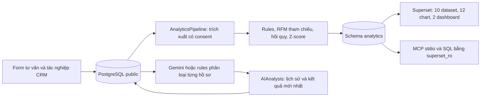

# Báo cáo kỹ thuật TH2 — AI Analytics và Apache Superset

Ngày đối chiếu mã nguồn và kiểm thử: **15/10/2026**. Ứng dụng là CRM B2B cho doanh nghiệp cung cấp giải pháp chuyển đổi số; không phải ERP kế toán/kho/nhân sự.

## 1. Kiến trúc và luồng dữ liệu



CRM Docker dùng PostgreSQL 16; môi trường local có thể dùng SQLite. Metadata Superset nằm ở database riêng. Superset đọc bốn view nghiệp vụ (`customer_monthly`, `lead_pipeline`, `care_task_summary`, `revenue_transactions`) và sáu bảng kết quả (`ai_lead_predictions`, `ai_sentiment_churn`, `ai_customer_rfm_segments`, `ai_revenue_forecast`, `ai_anomaly_alerts`, `ai_explainability_summary`).

Pipeline chạy theo yêu cầu bằng command hoặc nút POST có quyền `analyze_customer`. Sáu bảng được cập nhật trong transaction; Superset không có quyền ghi dữ liệu CRM. Sau thay đổi CRM, cần chạy lại pipeline để dashboard đọc kết quả mới. Chưa có CDC, lịch chạy nền hoặc bảo đảm cập nhật thời gian thực.

## 2. AI và các phương pháp thực tế

| Thành phần | Hiện thực | Giới hạn |
|---|---|---|
| Phân loại hồ sơ | Gemini trả JSON phân khúc/điểm/nhận định/đề xuất; fallback rules | LLM có thể sai; nhân viên rà soát, không tự gửi thư |
| Lead scoring | Công thức sigmoid với trọng số quy định; HOT/WARM/COLD, giá trị hợp đồng demo | Chưa học từ nhãn kết quả bán; không phải xác suất đã hiệu chuẩn |
| Sentiment/churn | Lexicon tiếng Việt, cụm dài, phủ định, độ trễ liên hệ và việc chưa xử lý | Hạn chế với mỉa mai, phủ định phức tạp; cảnh báo theo tương tác |
| RFM | Chuẩn hóa Recency/Frequency/Monetary rồi gán tâm tham chiếu cố định | Không huấn luyện K-Means, không có Silhouette thực nghiệm |
| Dự báo | Hồi quy tuyến tính theo tháng, điền tháng không có WON bằng 0, tối thiểu 3 tháng | Không phải Prophet/ARIMA; kết quả hiện chưa vượt baseline |
| Giải thích | Tổng hợp đóng góp thành phần công thức chấm điểm | Không phải SHAP hoặc suy luận nhân quả |
| Bất thường | Lead bị ngâm theo lần liên hệ gần nhất; Z-score giao dịch | Ngưỡng là giả định demo, cần hiệu chỉnh bằng dữ liệu thật |

Gemini tư vấn giữ ngữ cảnh nhiều lượt và có timeout/fallback; prompt yêu cầu không hứa giá, thời gian, gói dịch vụ hay SLA khi chưa có căn cứ. LLM vẫn có thể không tuân thủ, cần rà soát nội dung. Email nháp có bước người dùng xác nhận đã gửi bên ngoài; tạo nháp không gửi email.

## 3. Consent và phân quyền

Lead và từng phản hồi lưu consent AI riêng. Migration `0009` bổ sung consent nullable cho `Interaction`, tránh dùng nhầm hội thoại chưa được phép. Hồ sơ công khai chỉ đưa nhu cầu/phản hồi/chat có consent vào phân tích; chat cũ chưa rõ consent được loại. Prompt hồ sơ công khai lược bỏ trường tên/email/điện thoại của hồ sơ; người nhập vẫn cần tránh đưa dữ liệu nhạy cảm trực tiếp vào nội dung tự do.

MCP SQL mở connection riêng bằng `superset_ro`, chỉ nhận một SELECT, đặt transaction read-only và statement timeout. Kiểm tra thực tế xác nhận đọc được analytics và bị từ chối khi đọc `public.crm_customer`. Form follow-up dùng token hash, hạn dùng, một lần trả lời, thu hồi và `strict-origin` để giữ kiểm tra CSRF nhưng không gửi đường dẫn token qua Referer.

## 4. Superset và MCP

`superset/bootstrap_superset.py` dùng REST API để đăng ký 10 dataset, tạo/cập nhật 12 chart và hai dashboard: `crm-analytics-dashboard`, `crm-ai-intelligence-dashboard`. Chart AI dùng chung giữ đủ liên kết với cả hai dashboard. Tên phương pháp phản ánh code thực tế; bootstrap nhận diện tên cũ khi đổi tên để không tạo bản trùng.

MCP chạy bằng `python manage.py run_superset_mcp`, hỗ trợ initialize, notification, ping và tools qua stdio. Các tool gồm `superset_list_dashboards`, `superset_query_ai_insights`, `superset_execute_sql`, `superset_trigger_pipeline` (yêu cầu `confirm=true`). Không có HTTP MCP hay tool tự tạo chart; việc dựng biểu đồ được bootstrap qua REST. Không mô tả phần này như MCP chart-authoring đã hoàn chỉnh.

Đã kiểm tra 12 truy vấn biểu đồ thành công và hai dashboard hiển thị 8 chart mỗi dashboard (có chart dùng chung), không thấy lỗi chart hiển thị. Bằng chứng: [superset-live.json](validation/superset-live.json).


## 5. Đánh giá có thể tái lập

Lệnh `evaluate_ai_quality` tính kết quả từ từng tình huống và rolling-origin backtest, không in số liệu ghi cứng. Nguồn là bộ minh họa do nhóm biên soạn, có dùng để sửa prompt/rules, không phải tập kiểm định độc lập hoặc dữ liệu khách hàng thật.

- Gemini: 7/7 nhãn phân khúc phù hợp kỳ vọng trên các tình huống có consent; hồ sơ thứ tám không consent không được phân tích.
- Rules: cùng khớp 7/7 nhãn; nhận diện nhóm giải pháp 8/8 trên bộ nhỏ.
- Sentiment: 19/20 câu đúng nhãn; Accuracy 0,95, Macro F1 khoảng 0,9501. Một câu mỉa mai còn sai.
- Dự báo: MAE khoảng 4.431.953 VNĐ trên 4 tháng demo, cao hơn baseline tháng trước 3.500.000 VNĐ. Chưa đủ căn cứ dùng cho quyết định doanh thu.
- Không công bố ROC-AUC chuyển đổi, Silhouette, SHAP hoặc coverage 95,4% khi chưa có phép đo tương ứng.

Chi tiết ca sai ban đầu, prompt sửa, dữ liệu từng ca, độ bao phủ kiểm thử và giới hạn xem [báo cáo E2E/AI](kiem-thu-e2e-va-danh-gia-ai.md). Kết quả test cuối: [test-results.json](validation/test-results.json).

## 6. Vận hành và hướng phát triển

```powershell
docker compose --profile analytics up -d
python manage.py migrate
python manage.py seed_consultation_scenarios --analyze
python manage.py setup_superset_analytics
python superset/bootstrap_superset.py
python manage.py verify_superset_analytics
python manage.py run_superset_mcp --test
python scripts/verify_live_integrations.py --browser
```

Cần tiếp tục thu thập dữ liệu có nguồn và consent, xây bộ nhãn độc lập, so sánh mô hình với baseline, hiệu chuẩn điểm và thử khả dụng với nhân viên thực tế. Chưa có bằng chứng độ chính xác tổng quát hoặc sẵn sàng production. Cảnh báo dependency frontend và các phần chưa kiểm thử được ghi trong báo cáo kiểm thử.
