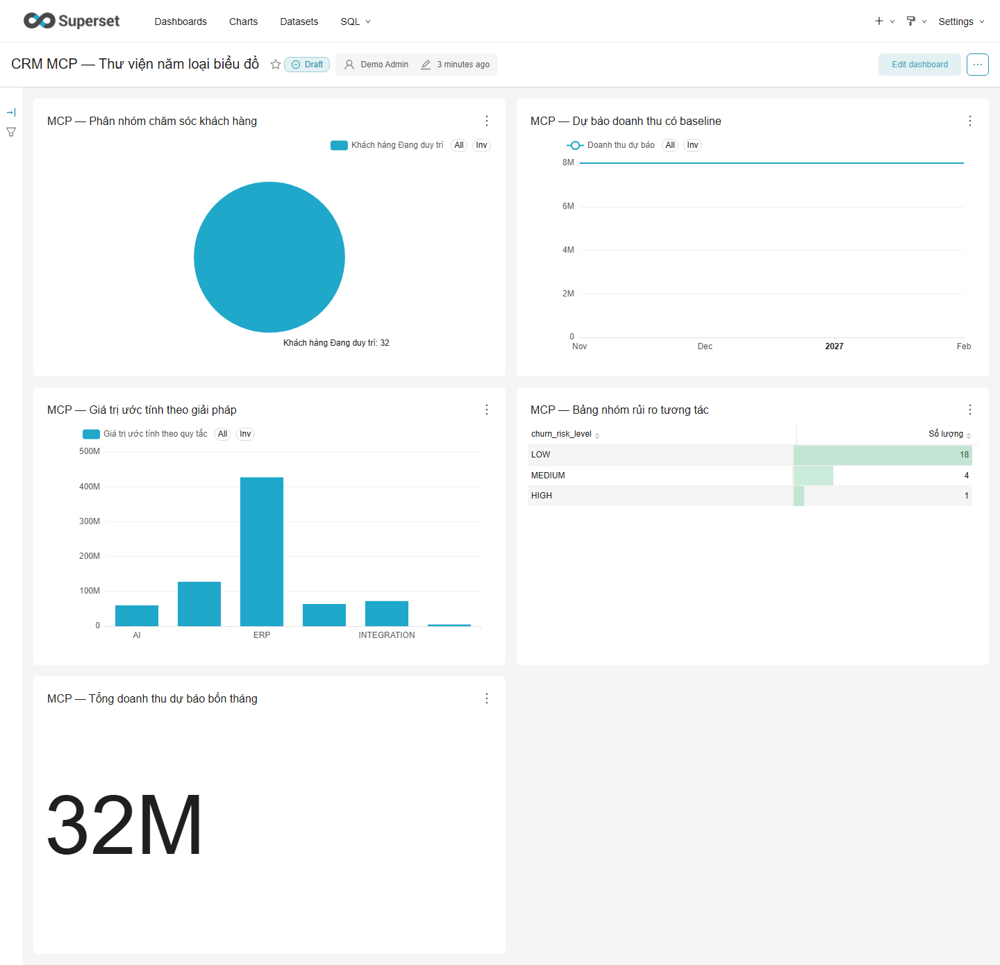

# Hoàn thiện TH2 sau đợt kiểm thử đầu — 15/10/2026

Nhánh `codex/complete-th2-gaps` tiếp tục từ commit `816461c`. Phạm vi là các lỗi/phần thiếu đã xác định, giữ nguyên CRM B2B và dữ liệu hiện có. Không gửi email ra ngoài, không nhập dữ liệu khách hàng thật.

## Các phần đã khắc phục

| Phần thiếu/lỗi | Kết quả |
|---|---|
| MCP chỉ đọc, chưa tạo chart | Thêm khám phá dataset/cột, tạo chart và dashboard qua MCP stdio. Hỗ trợ pie/bar/line/table/number, count/sum/avg/min/max; chỉ dataset CRM analytics, kiểm tra cột và cột số. |
| Ghi đè hoặc tạo trùng cấu hình BI | Gọi lại cấu hình giống nhau dùng lại ID; khác cấu hình mặc định báo lỗi. Chỉ chart do MCP quản lý trên cùng dataset được sửa khi chủ động `replace_existing=true`. Dashboard mặc định nháp; chart giữ liên kết dashboard cũ. Bootstrap cũng giữ liên kết ngoài hai dashboard chuẩn. |
| Chart truy vấn được nhưng lỗi render | Kiểm thử live phát hiện pie cần `metric` thay vì `metrics`; đã sửa và chạy lại dashboard bằng browser. Bằng chứng truy vấn và hiển thị tách riêng. |
| 7 cảnh báo dependency frontend | Nâng Tailwind 3.4.19 lên 4.3.3; override watcher 2.6.0 để loại micromatch/braces. Giữ bảng màu cũ và các kích thước giao diện tương thích. Audit không bị bỏ qua; CI chặn từ mức moderate. |
| Hồi quy doanh thu kém baseline | Dùng baseline khi dưới 18 tháng. Khi đủ lịch sử, so sánh tuyến tính/trung bình 3 tháng trên tối đa 6 fold quá khứ; cần ít nhất 5 fold, MAE tốt hơn baseline 10% và tốt hơn ở 2 fold gần nhất. |
| Dải dự báo bị gọi là tin cậy 95% | Đổi nhãn thành dải sai số tham khảo chưa hiệu chuẩn. Giữ tên cột cũ `*_95` để không phá dataset; không công bố độ bao phủ khi chưa đo. |
| Điểm lead giả định phản hồi trong 2 giờ | Chỉ dùng thời điểm gửi follow-up đã ghi nhận; thiếu dữ liệu không được cộng điểm tốc độ. Giải thích không gọi số lần trao đổi là cảm xúc tích cực. |
| AI lẫn lời trợ lý với lời khách | Lọc lượt khách trong transcript có nhãn trước khi phân loại/sentiment; không lấy gợi ý của trợ lý làm bằng chứng khách muốn hủy hoặc mất dữ liệu. |
| Sentiment sai câu phủ định tu từ | Xử lý cấu trúc “hài lòng gì mà…”, “tốt đâu” theo mẫu ngữ pháp; không khẳng định hiểu mọi kiểu mỉa mai. |
| Chat có thể hứa giá/tiến độ chưa xác nhận | Câu hỏi thương mại được nhận diện về giá/tiến độ/cam kết đi qua trả lời cục bộ, không để Gemini tự sinh báo giá. Những cách diễn đạt chưa nhận diện vẫn cần rà soát. |
| Chỉ kiểm thử Chromium, SMTP trong bộ nhớ | Thêm lựa chọn Firefox/WebKit và kiểm tra SMTP qua socket loopback, gồm MIME/link thực và máy chủ từ chối người nhận. CI chạy cả ba engine. |
| WebKit đọc ô nháp quá sớm | Test chờ nội dung được tải trước khi kiểm tra; ảnh/trace xác nhận bản nháp đã được tạo, không nới điều kiện nội dung. |

## Kết quả và bằng chứng

Kết quả kiểm thử cuối cùng nằm tại [completion-test-results.json](validation/completion-test-results.json); số liệu được lấy từ log thực tế, không phải số dự kiến. Kết quả dependency ở [dependency-audit.json](validation/dependency-audit.json).

- PostgreSQL và SQLite kèm Chromium: bộ 131 test chạy thành công, lần lượt bỏ qua 5 test browser và 1 test chỉ dành cho PostgreSQL.
- Firefox: 5 luồng browser đạt; WebKit: 5 luồng đạt sau sửa cách chờ. Playwright WebKit không thay thế Safari trên thiết bị thật.
- SMTP: gửi multipart/link phản hồi qua socket cục bộ đạt; máy chủ trả 550 thì không có tương tác đã gửi, không giữ token còn hiệu lực. Không kiểm thử khả năng phát thư đến hộp thư nhà cung cấp thật.
- Superset: xem [truy vấn và render](validation/superset-live.json), [tạo qua MCP](validation/mcp-authoring-live.json) và [thử đủ năm loại biểu đồ](validation/mcp-authoring-gallery.json). Các dashboard MCP được lưu nháp để xem lại trước khi công bố.

Lượt cuối kiểm tra 17 truy vấn thành công và 4 dashboard không có lỗi hiển thị: hai dashboard chuẩn và hai dashboard nháp MCP. Có thêm 43 test hồi quy cuối cùng đạt, bỏ qua một test chỉ dành cho PostgreSQL.



[Giao diện CRM desktop sau nâng build](validation/crm-report-v4.png) · [Hồ sơ mobile](validation/crm-profile-mobile-v4.png)

### Đánh giá AI sau sửa

[Rules và backtest](validation/ai-quality-followup.json); [lượt phân tích hồ sơ mới nhất](validation/ai-quality-followup-gemini.json); [hội thoại và email nháp](validation/live-ai-conversation.json).

| Phép đo | Kết quả trên dữ liệu minh họa |
|---|---|
| Phân khúc 7 hồ sơ có consent | 7/7 nhãn đúng kỳ vọng; 6 Gemini, 1 fallback rules. Không tính fallback thành thành công Gemini. |
| Hồ sơ không consent | Không chạy AI; tiếp tục tiếp nhận thủ công. |
| Rules phân khúc / nhóm giải pháp | 7/7 và 8/8 trên bộ tình huống phát triển. |
| Sentiment | 20/20 nhãn khớp sau sửa phủ định tu từ; bộ ca đã được dùng trong phát triển. |
| Doanh thu rolling-origin 4 tháng | MAE 3.500.000 VNĐ, bằng baseline; hồi quy cũ 4.431.953 VNĐ trên cùng các tháng. |

Ngưỡng 18 tháng là chính sách vận hành thận trọng, không phải định lý bảo đảm chính xác. Cả bộ sentiment và phân khúc đều đã dùng để sửa code/prompt; không được gọi là kiểm định độc lập hoặc công bố “AI chính xác 100%”. Chọn baseline là sửa cách dùng mô hình chưa có bằng chứng, không phải chứng minh đã xây được mô hình dự báo vượt baseline. Điểm lead và giá trị hợp đồng vẫn là quy tắc demo chưa hiệu chuẩn theo nhãn WON/LOST.

## Đối chiếu 6 mục TH2

1. Có kiến trúc và luồng CRM → PostgreSQL → analytics → Superset; cập nhật theo yêu cầu, chưa phải thời gian thực.
2. Có Gemini/rules và nhiều phương pháp phân tích; có phép đo tái lập, ca sai và fallback.
3. Có kết nối Superset, **MCP tạo chart/dashboard đã kiểm tra trực tiếp**, không còn chỉ đọc.
4. Dashboard đọc kết quả từ analytics; đã kiểm tra query và render, không dựng số liệu mẫu để thay dữ liệu thiếu.
5. Có báo cáo kiến trúc, luồng, phương pháp, kiểm thử và giới hạn chất lượng.
6. Có nhiều phương pháp và đề xuất mở rộng; việc cộng điểm thuộc tiêu chí chấm của giảng viên.

Như lựa chọn của người dùng, 8 hồ sơ bổ sung vẫn là tình huống B2B minh họa, không phải dữ liệu khách hàng thật. Nếu đề bài bắt buộc nguồn dữ liệu thực tế độc lập, cần có dữ liệu được phép sử dụng và kiểm định tiếp; không đổi nhãn dữ liệu giả thành thật để đánh dấu hoàn thành.

## Giao diện và việc cần xác minh bên ngoài code

Đã thao tác tìm khách, phân tích, tạo việc, soạn nháp, follow-up và báo cáo ở desktop/mobile trên ba engine. Các điểm thao tác và bố cục cũ được giữ sau đổi compiler. Chưa có cơ sở thay một nghiên cứu với nhân viên thực tế bằng kết luận từ browser tự động.

Khi có người thử, dùng cùng 5 tác vụ: tìm An Phúc; giải thích vì sao Sao Mai cần hỗ trợ trước; tạo việc theo đề xuất; sửa và ghi nhận email đã gửi; tìm nguồn số liệu dự báo. Ghi thời gian, số lần cần trợ giúp và lỗi thao tác cho 3–5 nhân viên. Không lấy dữ liệu thử này làm nhãn độ chính xác mô hình.

Chưa thể tự xác minh: hiệu quả trên khách thật, trải nghiệm của nhân viên thật, phát thư SMTP nhà cung cấp thật, tải production và một cuộc kiểm thử xâm nhập toàn diện. Đây là các đánh giá ngoài môi trường local, không phải lỗi đã được chứng minh tồn tại trong code. Cấu hình triển khai vẫn cần HTTPS, giới hạn request và backup theo tải thực tế.

## Dữ liệu, migration và tệp thay đổi

- Không thêm/sửa model hoặc schema tác nghiệp ở đợt này, không có migration mới. Migration `0009` của đợt trước vẫn giữ nguyên; migration check không phát hiện thay đổi.
- Không tạo thêm hồ sơ ngoài 8 tình huống đã có; chạy lại phân tích được cho phép lưu thêm lịch sử. Không xóa tương tác cũ.
- AI và phân tích: `crm/analytics/{ai_engine,evaluation,pipeline}.py`, `crm/services/{ai_chat_service,ai_service,consultation}.py`.
- MCP/BI: `superset/authoring.py`, `superset/{mcp_server,bootstrap_superset}.py`, `scripts/verify_mcp_authoring.py`, `scripts/verify_live_integrations.py`.
- Giao diện/build: `crm/templates/crm/report.html`, CSS build, `tailwind/package*.json`, config, nguồn CSS và `legacy-colors.json`.
- Kiểm thử/CI: `crm/test_th2_completion.py`, `crm/test_smtp_delivery.py`, `crm/test_browser_e2e.py`, `.github/workflows/ci.yml`.
- Tài liệu: README, AGENTS (cập nhật phiên bản build thực tế), roadmap, báo cáo kỹ thuật, kịch bản demo và JSON/ảnh minh chứng.

## Tái lập

```powershell
python manage.py check
python manage.py makemigrations --check --dry-run
python manage.py test
$env:USE_SQLITE = "1"
$env:RUN_BROWSER_E2E = "1"
python manage.py test
$env:CRM_E2E_BROWSER = "firefox"
python manage.py test crm.test_browser_e2e
$env:CRM_E2E_BROWSER = "webkit"
python manage.py test crm.test_browser_e2e
Remove-Item Env:CRM_E2E_BROWSER, Env:RUN_BROWSER_E2E, Env:USE_SQLITE
python scripts/verify_mcp_authoring.py --all-kinds
python scripts/verify_live_integrations.py --browser
python manage.py evaluate_ai_quality
python -m pip_audit -r requirements-e2e.txt
cd tailwind
npm ci
npm audit --audit-level=moderate
npm run css:build
```

Tham khảo quyết định dependency: [advisory braces chưa có bản vá phát hành](https://github.com/advisories/GHSA-vfj7-8cjw-p6xm), [hướng dẫn nâng Tailwind chính thức](https://tailwindcss.com/docs/upgrade-guide). Tạo chart qua MCP sử dụng [API chart Superset](https://superset.apache.org/developer-docs/api/create-a-new-chart/); xác nhận hoạt động dựa trên Superset local chứ không chỉ tài liệu API.
