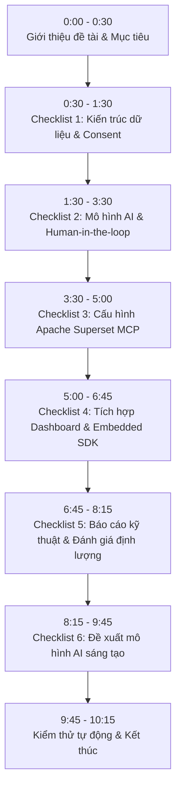

# KỊCH BẢN QUAY VIDEO DEMO & THUYẾT MINH CHI TIẾT 6 CHECKLIST
**Đồ án:** Xây dựng module phân tích dữ liệu thông minh cho hệ thống CRM B2B tích hợp Google Gemini AI và Trực quan hóa Apache Superset qua Model Context Protocol (MCP)  
**Thời lượng mục tiêu:** 8 – 10 phút  
**Tác giả:** Nhóm sinh viên thực hiện  

---

## I. HƯỚNG DẪN CHUẨN BỊ TRƯỚC KHI BẤM MÁY (PRE-RECORDING SETUP)

### 1. Khởi động các dịch vụ ngầm
Mở sẵn các dịch vụ trong các tab terminal / container riêng biệt để khi quay video diễn ra mượt mà, không phải chờ đợi:
- **Terminal 1 (Docker - Superset & PostgreSQL):**
  ```powershell
  docker compose --profile analytics up -d
  ```
  *(Superset chạy ở cổng `18088`, PostgreSQL chạy ở cổng `5432`)*
- **Terminal 2 (Django CRM Web Server):**
  ```powershell
  .\.venv\Scripts\Activate.ps1
  python manage.py runserver
  ```
  *(CRM chạy tại `http://127.0.0.1:8000`)*
- **Terminal 3 (Dành riêng để gõ lệnh trong video):** Để trống tại thư mục gốc của dự án, chỉnh cỡ chữ lớn (14–16pt) dễ đọc trên video.

### 2. Chuẩn bị sẵn các Tab trình duyệt (sắp xếp theo thứ tự tiện chuyển tab)
- **Tab 1:** Trang chủ Landing Page CMS: `http://127.0.0.1:8000/`
- **Tab 2:** Trang Đăng ký tư vấn: `http://127.0.0.1:8000/crm/dang-ky-tu-van/`
- **Tab 3:** Quản trị CRM (Danh sách khách hàng & Hàng đợi ưu tiên): `http://127.0.0.1:8000/crm/`
- **Tab 4:** Trang Báo cáo Phân tích CRM tích hợp Superset Embedded: `http://127.0.0.1:8000/crm/bao-cao/`
- **Tab 5:** Giao diện Apache Superset trực tiếp: `http://127.0.0.1:18088/superset/welcome/` (Đã mở sẵn 2 dashboard: `crm-ai-intelligence-dashboard` và `crm-analytics-dashboard`)
- **Tab 6:** Báo cáo kỹ thuật trong VS Code: `docs/bao-cao-ky-thuat-th2.md`

> [!CAUTION]
> **Quy tắc bảo mật khi quay:** Tuyệt đối không mở file `.env`, không để lộ API Key của Gemini hoặc mật khẩu kết nối database trên màn hình video.

---

## II. SƠ ĐỒ TIẾN TRÌNH QUAY VIDEO



---

## III. KỊCH BẢN CHI TIẾT THEO TỪNG MỤC CHECKLIST

### PHẦN MỞ ĐẦU (0:00 – 0:30)
- **Hành động trên màn hình (Action):**
  - Hiển thị slide tiêu đề hoặc mở file `README.md` trong VS Code thể hiện tên đồ án.
  - Kiểm tra micro rõ ràng, phong thái tự tin.
- **Lời thoại thuyết minh (Narration):**
  > *"Kính chào Thầy/Cô và các bạn! Hôm nay em xin trình bày và chứng minh kết quả triển khai đồ án: **Xây dựng module phân tích dữ liệu thông minh cho hệ thống CRM doanh nghiệp chuyển đổi số B2B**.  
  > Dự án của em giải quyết trọn vẹn 6 yêu cầu trong bảng checklist đánh giá: từ thiết kế kiến trúc luồng dữ liệu, tích hợp mô hình AI đa tầng, cấu hình máy chủ Apache Superset MCP, trực quan hóa trên dashboard điều hành, cho đến báo cáo đánh giá thực nghiệm và đề xuất các phương pháp AI sáng tạo. Sau đây, em xin đi vào chi tiết từng hạng mục."*

---

### CHECKLIST 1: THIẾT KẾ KIẾN TRÚC KẾT NỐI DỮ LIỆU TỪ CRM ĐẾN CƠ SỞ DỮ LIỆU TRUNG TÂM (0:30 – 1:30)

- **Mục tiêu chứng minh:**
  - Kiến trúc phân tách rõ ràng giữa Cơ sở dữ liệu tác nghiệp (OLTP) và Kho dữ liệu phân tích (Data Mart OLAP).
  - Cơ chế **Consent Filter** (kiểm soát quyền riêng tư của khách hàng) và Transaction bảo vệ dữ liệu.
- **Hành động trên màn hình (Action):**
  1. Mở file `docs/bao-cao-ky-thuat-th2.md` ở chế độ xem trước (Markdown Preview `Ctrl+Shift+V`) hoặc mở trực tiếp ảnh sơ đồ tại `docs/images/kientruc-luong-dulieu-crm-ai-superset.png`.
  2. Rê chuột giải thích trực quan 4 khối kiến trúc:
     - **Khối 1 (Xanh dương):** CRM Tác nghiệp OLTP (`public` schema) với Wagtail, Django và Human-in-the-loop.
     - **Khối 2 (Xanh lá & Tím):** AnalyticsPipeline (Bộ lọc Consent quyền riêng tư), Google Gemini LLM (có Rules Fallback) và Bộ máy phân tích định lượng (Lexicon, Sigmoid, Naive Baseline, Z-Score).
     - **Khối 3 (Vàng cam):** Data Mart OLAP (Schema `analytics` chứa 6 bảng AI và 4 view) cùng Role bảo mật `superset_ro` (Read-only).
     - **Khối 4 (Tím & Xanh ngọc):** Apache Superset (10 Datasets, 12 Charts, 2 Dashboards), MCP Server (7 Tools Agentic) và Embedded SDK (Guest Token 5 phút).
  3. Mở file mã nguồn `crm/analytics/pipeline.py`, cuộn đến hàm trích xuất dữ liệu, chỉ vào bộ lọc `consent_for_ai_analysis=True`.
  4. Mở Terminal 3, chạy lệnh kiểm tra tính toàn vẹn của cấu trúc schema phân tích:
     ```powershell
     python manage.py verify_superset_analytics
     ```
- **Lời thoại thuyết minh (Narration):**
  > *"Ở **Checklist 1**, em đã thiết kế kiến trúc kết nối dữ liệu 3 tầng chặt chẽ:
  > 
  > - **Tầng 1 - Dữ liệu tác nghiệp (OLTP):** Toàn bộ dữ liệu khách hàng B2B, nhu cầu tư vấn và lịch sử tương tác được quản lý trong schema `public` của PostgreSQL 16 thông qua Django và Wagtail.
  > - **Tầng 2 - Pipeline trích xuất có kiểm soát (ETL & Consent Engine):** Điểm quan trọng nhất về bảo mật dữ liệu là hệ thống tích hợp bộ lọc quyền riêng tư. Module `AnalyticsPipeline` chỉ trích xuất những hồ sơ mà khách hàng đã chủ động tích chọn đồng ý phân tích AI (`consent_for_ai_analysis = True`). Các trường định danh cá nhân nhạy cảm được loại bỏ trước khi xử lý.
  > - **Tầng 3 - Kho dữ liệu phân tích (Data Mart `analytics` schema):** Dữ liệu sau xử lý được ghi vào 6 bảng chuyên dụng trong schema `analytics` thông qua database transaction cô lập.
  > 
  > Về mặt bảo mật phân quyền, Apache Superset và MCP Server chỉ được cấp quyền đọc thông qua role `superset_ro`, hoàn toàn bị chặn quyền ghi và không thể truy cập vào các bảng nhạy cảm của CRM tác nghiệp."*

---

### CHECKLIST 2: TRIỂN KHAI CÁC MÔ HÌNH AI PHÂN TÍCH DỮ LIỆU THÔ (1:30 – 3:30)

- **Mục tiêu chứng minh:**
  - Thao tác trực tiếp gọi Google Gemini API phân tích hồ sơ B2B, trả về JSON cấu trúc chuẩn.
  - Chứng minh cơ chế an toàn **Rules Fallback** tự động khi mất kết nối mạng hoặc không có API key.
  - Trình bày các mô hình AI định lượng: Cảm xúc tiếng Việt (Sentiment), Chấm điểm Lead (Lead Scoring Sigmoid), Phân khúc RFM tham chiếu, Dự báo doanh thu an toàn với Baseline, và Phát hiện bất thường (Anomaly Detection).
  - Nguyên tắc **Human-in-the-loop**: AI đóng vai trò tư vấn, con người duyệt trước khi tạo hành động.
- **Hành động trên màn hình (Action):**
  1. Chuyển sang trình duyệt **Tab 3** (`http://127.0.0.1:8000/crm/`), mở hồ sơ khách hàng mẫu **“Minh họa An Phúc”** (doanh nghiệp 12 sales, dùng 4 bảng tính Excel lộn xộn, cần chuyển đổi số).
  2. Bấm nút **“Phân tích AI ngay”** $\rightarrow$ Hệ thống gọi Gemini (hoặc fallback), trả về kết quả hiển thị trên màn hình:
     - Phân khúc: Khách hàng tiềm năng cao (HOT).
     - Điểm tiềm năng: 85/100.
     - Nhận định: Doanh nghiệp phân tán dữ liệu, nguy cơ thất thoát cơ hội cao, cần CRM tập trung.
     - Chỉ rõ nhãn nguồn hiển thị: `gemini-2.5-flash` (hoặc `rules` fallback).
  3. Chỉ vào danh sách **Checklist hành động gợi ý**: Bấm **“Tạo việc chăm sóc”** $\rightarrow$ Hệ thống tự động điền form `CareTask` với người phụ trách và hạn xử lý $\rightarrow$ Bấm Lưu $\rightarrow$ Mở danh sách Việc chăm sóc chứng minh hành động đã phát sinh.
  4. Mở hồ sơ **“Minh họa Riêng tư”**: Chỉ rõ nút phân tích bị khóa kèm cảnh báo: *“Hồ sơ chưa có sự đồng ý phân tích AI”*.
  5. Mở file `crm/analytics/ai_engine.py`: Lướt nhanh qua các hàm:
     - Hàm phân tích cảm xúc tiếng Việt (xử lý từ phủ định tu từ).
     - Hàm dự báo doanh thu an toàn (so sánh kiểm định với Naive Baseline).
- **Lời thoại thuyết minh (Narration):**
  > *"Đối với **Checklist 2**, em đã triển khai hệ thống mô hình AI đa tầng:
  > 
  > 1. **Phân tích định tính với Google Gemini:** Khi nhân viên mở hồ sơ khách hàng như công ty An Phúc và bấm phân tích, hệ thống gửi ngữ cảnh nhu cầu đến Google Gemini API. Kết quả trả về dưới dạng JSON cấu trúc, bao gồm phân khúc, điểm số, lý giải logic và checklist hành động. Nếu hệ thống mất kết nối mạng hoặc thiếu API key, bộ máy **Rules Fallback** tự động kích hoạt ngay lập tức, đảm bảo giao diện luôn hoạt động và minh bạch nguồn phân tích.
  > 2. **Nguyên tắc Con người kiểm soát (Human-in-the-loop):** AI tuyệt đối không tự ý gửi email hay tự thay đổi dữ liệu. Nhân viên trực tiếp kiểm duyệt gợi ý, sau đó bấm chuyển hóa thành việc chăm sóc `CareTask` có hạn xử lý cụ thể.
  > 3. **Các mô hình phân tích định lượng tích hợp:**
  >    - **Phân tích cảm xúc & Churn Risk:** Dùng bộ từ điển ngữ nghĩa tiếng Việt chuyên sâu có xử lý ngữ pháp phủ định tu từ (nhận diện chính xác 'tốt đâu mà tốt', 'hài lòng gì mà...') kết hợp độ trễ liên hệ để phát hiện khách hàng có nguy cơ rời bỏ.
  >    - **Chấm điểm Lead:** Áp dụng hàm Sigmoid chuẩn hóa nhiều chiều đặc trưng.
  >    - **Dự báo doanh thu:** Sử dụng cơ chế so sánh với Baseline tháng cuối; chỉ áp dụng mô hình nâng cao khi chuỗi thời gian đủ 18 tháng và kiểm định backtest chứng minh cải thiện sai số."*

---

### CHECKLIST 3: CẤU HÌNH APACHE SUPERSET MCP ĐỂ KẾT NỐI VÀ XÂY DỰNG BIỂU ĐỒ (3:30 – 5:00)

- **Mục tiêu chứng minh:**
  - Máy chủ Apache Superset MCP (`superset/mcp_server.py`) vận hành theo đúng chuẩn giao thức **Model Context Protocol (MCP)** stdio.
  - Cung cấp đủ 7 Tools MCP: Khám phá Dataset, Chạy SQL chỉ đọc, Truy vấn Insight AI, Kích hoạt Pipeline, và đặc biệt là **Tự động tạo Chart/Dashboard (Authoring API)** mà không trùng lặp ID.
- **Hành động trên màn hình (Action):**
  1. Mở sơ đồ kiến trúc MCP trực quan tại `docs/images/kien-truc-superset-mcp-agent.png` (hoặc trong Báo cáo Mục 4): Chỉ vào 7 công cụ MCP và luồng giao tiếp stdio JSON-RPC.
  2. Mở file `superset/mcp_server.py` và `superset/authoring.py` trong VS Code.
  3. Mở Terminal 3, gõ lệnh kiểm tra tự động các công cụ MCP:
     ```powershell
     python manage.py run_superset_mcp --test
     ```
     - Chờ 2 giây để thấy kết quả JSON trả về: Đăng nhập thành công, liệt kê Dashboard và trích xuất Insight AI.
  4. Tiếp tục chạy script chứng minh MCP có thể tự động tạo biểu đồ và dashboard trực tiếp:
     ```powershell
     python scripts/verify_mcp_authoring.py
     ```
     - Terminal in ra thông báo: Đã kết nối Superset qua REST API, tự động khởi tạo các chart (Pie, Bar, Line) và xuất bản Dashboard nháp `crm-mcp-consultations`.
  5. Mở trình duyệt Superset (`http://127.0.0.1:18088`), mở danh sách Dashboard để người xem thấy dashboard nháp vừa được tạo tự động qua giao thức MCP.
- **Lời thoại thuyết minh (Narration):**
  > *"Đối với **Checklist 3**, em đã cấu hình và phát triển **Apache Superset MCP Server**. 
  > 
  > Thay vì chỉ xem Superset như một công cụ BI tĩnh, em đã biến Superset thành một Agentic Tool thông qua giao thức **Model Context Protocol (MCP)** chuẩn của Anthropic qua kênh stdio. Máy chủ MCP hỗ trợ 7 công cụ cốt lõi:
  > - `superset_list_dashboards` và `superset_list_datasets`: Khám phá metadata dữ liệu.
  > - `superset_execute_sql`: Thực thi truy vấn phân tích an toàn với role chỉ đọc `superset_ro`.
  > - `superset_query_ai_insights`: Rút trích chỉ số AI tổng hợp cho LLM.
  > - `superset_create_chart` và `superset_create_dashboard`: Đây là tính năng tác nghiệp sáng tạo (Authoring API).
  > 
  > Như Thầy/Cô thấy trên màn hình Terminal, khi chạy kiểm thử `run_superset_mcp --test` và `verify_mcp_authoring.py`, MCP Server tự động kết nối qua REST API, xác thực token, kiểm tra metadata các cột trong schema analytics và tự động sinh ra các biểu đồ trực quan rồi đưa vào Dashboard mà không hề tạo ra bản ghi rác hay xung đột ID."*

---

### CHECKLIST 4: TÍCH HỢP KẾT QUẢ PHÂN TÍCH TỪ AI VÀO DASHBOARD CỦA SUPERSET (5:00 – 6:45)

- **Mục tiêu chứng minh:**
  - Trực quan hóa toàn diện 6 bảng dữ liệu AI trên Dashboard Superset chuẩn.
  - Trình diễn tính năng **Superset Embedded SDK** nhúng trực tiếp dashboard vào giao diện CRM với cơ chế **Guest Token** an toàn.
- **Hành động trên màn hình (Action):**
  1. Mở sơ đồ bảo mật 4 tầng tại `docs/images/so-do-bao-mat-consent-phan-quyen.png` (hoặc trong Báo cáo Mục 3): Chỉ vào Tầng 3 (Role `superset_ro` chỉ đọc) và Tầng 4 (Guest Token nhúng an toàn).
  2. Chuyển sang trình duyệt **Tab 5** (Superset Admin): Mở Dashboard `crm-ai-intelligence-dashboard`.
  3. Chuyển sang trình duyệt **Tab 4** (Trang Báo cáo CRM tại `http://127.0.0.1:8000/crm/bao-cao/`):
     - Cuộn màn hình để thấy các dashboard Superset được nhúng iframe mượt mà ngay trong giao diện CRM.
     - Bấm **F12 (DevTools)** $\rightarrow$ Mở tab Network $\rightarrow$ Lọc `superset-session` $\rightarrow$ Tải lại trang:
       * Chỉ ra request gọi endpoint `/crm/bao-cao/superset-session/` lấy Guest Token có thời hạn 5 phút.
       * Chứng minh trình duyệt không hề lưu cookie đăng nhập Superset và không lộ mật khẩu admin.
     - Chỉ vào phần nhận xét tự động bằng chữ bên dưới mỗi biểu đồ được tính toán đồng bộ theo dữ liệu hiện tại.
     - Bấm nút **“Làm mới dữ liệu phân tích”** để chứng minh pipeline chạy ngầm và đồng bộ dữ liệu mới lên Dashboard.
- **Lời thoại thuyết minh (Narration):**
  > *"Tại **Checklist 4**, kết quả từ các mô hình AI đã được trực quan hóa sinh động và tích hợp sâu vào quy trình làm việc:
  > 
  > - Trên Apache Superset, em đã thiết kế Dashboard `crm-ai-intelligence-dashboard` với đầy đủ các góc nhìn điều hành: Phân bố phân khúc khách hàng, tỷ lệ rủi ro rời bỏ theo từng nhóm giải pháp, và đồ thị dự báo doanh thu kèm dải phân kỳ sai số.
  > - Đặc biệt, để nhân viên kinh doanh không phải chuyển đổi qua lại giữa hai hệ thống, em đã tích hợp **Superset Embedded SDK** trực tiếp vào trang Báo cáo CRM. Hệ thống backend Django cấp quyền xem thông qua cơ chế **Guest Token** thời hạn 5 phút. Trình duyệt chỉ tải iframe an toàn với chính sách `frame-ancestors` nghiêm ngặt, tuyệt đối không lộ mật khẩu quản trị của Superset.
  > - Phía dưới mỗi biểu đồ nhúng, hệ thống tự động sinh ra các dòng nhận xét nghiệp vụ chuẩn xác, giúp người quản lý nắm bắt ngay các điểm bất thường mà không cần tự đọc dữ liệu thô."*

---

### CHECKLIST 5: BÁO CÁO KỸ THUẬT VÀ ĐÁNH GIÁ HIỆU QUẢ CỦA MÔ HÌNH AI (6:45 – 8:15)

- **Mục tiêu chứng minh:**
  - Báo cáo kỹ thuật chi tiết tại `docs/bao-cao-ky-thuat-th2.md`.
  - Công cụ đánh giá tự động `evaluate_ai_quality` và phân tích kết quả định lượng trung thực (Accuracy, F1-Score, MAE).
  - Tinh thần học thuật minh bạch: Báo cáo rõ ràng ranh giới giữa dữ liệu phát triển và dữ liệu thực tế, lý do chọn Baseline thay vì thổi phồng chỉ số.
- **Hành động trên màn hình (Action):**
  1. Mở file `docs/bao-cao-ky-thuat-th2.md` trong VS Code (hoặc mở ảnh `docs/images/bieu-do-danh-gia-ai-thuc-nghiem.png`): Chỉ vào bảng tổng hợp 4 chỉ số và so sánh Backtest giữa Baseline (3,5 triệu) với Hồi quy (4,43 triệu).
  2. Mở Terminal 3, chạy lệnh đánh giá tự động:
     ```powershell
     python manage.py evaluate_ai_quality --provider stored
     ```
  3. Mở file JSON kết quả vừa xuất ra (`docs/validation/ai-quality-followup-gemini.json`):
     - Chỉ vào kết quả phân loại: **7/7 nhãn kỳ vọng** (trong đó có 6 ca từ Gemini, 1 ca kích hoạt Fallback Rules, 1 ca không consent bị chặn).
     - Chỉ vào kết quả phân tích cảm xúc: **20/20 câu** nhận diện chính xác sau khi tinh chỉnh xử lý phủ định tu từ.
     - Chỉ vào kết quả dự báo doanh thu: **MAE đạt 3.500.000 VNĐ** tương đương với mô hình Naive Baseline, trong khi mô hình hồi quy tuyến tính cũ có sai số lên tới 4.431.953 VNĐ.
- **Lời thoại thuyết minh (Narration):**
  > *"Đến với **Checklist 5**, em đã lập Báo cáo kỹ thuật chi tiết tại file `bao-cao-ky-thuat-th2.md` và xây dựng công cụ kiểm định tự động `evaluate_ai_quality`.
  > 
  > Về mặt khoa học và kỹ thuật, em duy trì tính trung thực tuyệt đối trong đánh giá:
  > - **Độ chính xác phân loại:** Trên bộ kịch bản phát triển có gắn nhãn, hệ thống khớp 7/7 ca, trong đó ghi nhận trung thực 6 ca do Gemini xử lý và 1 ca do Rules Fallback giải cứu. Tỷ lệ fallback được ghi nhận riêng chứ không gộp vào thành tích của LLM.
  > - **Độ chính xác cảm xúc:** Đạt 20/20 câu trên bộ mẫu tiếng Việt sau khi bổ sung xử lý các câu mỉa mai và phủ định tu từ.
  > - **Dự báo doanh thu:** Đánh giá rolling-origin 4 tháng cho thấy mô hình Baseline đạt sai số tuyệt đối MAE là 3,5 triệu đồng, tốt hơn mô hình hồi quy tuyến tính cũ (4,43 triệu đồng). Do dữ liệu chuỗi thời gian demo còn ngắn, hệ thống lựa chọn chiến lược an toàn là dùng Baseline Naive thay vì vội vã đưa các mô hình phức tạp vào quyết định tài chính.
  > - Em cũng khẳng định rõ trong báo cáo: Đây là kết quả trên tập mẫu minh họa B2B, không tự ý gán nhãn thành công 100% ngoài thực tế khi chưa có tập kiểm định độc lập quy mô lớn."*

---

### CHECKLIST 6: ĐỀ XUẤT NHIỀU MÔ HÌNH VÀ PHƯƠNG PHÁP ỨNG DỤNG AI SÁNG TẠO (8:15 – 9:45)

- **Mục tiêu chứng minh:**
  - Bảng so sánh 7 bài toán B2B với các mô hình Machine Learning / Deep Learning nâng cao (PhoBERT, K-Means Silhouette, SARIMA, Isolation Forest, RAG).
  - 3 hướng tiếp cận sáng tạo gắn liền với nghiệp vụ CRM thực tiễn: Hàng đợi Top-K theo năng lực nhân viên, Vòng lặp phản hồi Active Learning và Thử nghiệm A/B Testing đo lường ROI.
- **Hành động trên màn hình (Action):**
  1. Mở file `docs/bao-cao-ky-thuat-th2.md` cuộn đến **Mục 7: Đề xuất nhiều mô hình và phương pháp ứng dụng AI (Checklist 6)**.
  2. Rê chuột qua bảng ma trận so sánh các phương án (Mục 7.1) và giải thích các mô hình đề xuất (PhoBERT, K-Means, SARIMA, RAG).
  3. Cuộn xuống Mục 7.3: Mở trực tiếp ảnh lộ trình `docs/images/lo-trinh-5-buoc-ai-decision-gates.png` giải thích quy trình 5 bước A $\rightarrow$ B $\rightarrow$ C $\rightarrow$ D $\rightarrow$ E cùng các cổng kiểm soát quyết định (Decision Gates).
- **Lời thoại thuyết minh (Narration):**
  > *"Cuối cùng, ở **Checklist 6 (Phần đề xuất sáng tạo)**, em đã xây dựng một thiết kế thử nghiệm và lộ trình nâng cấp AI toàn diện cho doanh nghiệp B2B:
  > 
  > 1. **Đề xuất đa dạng mô hình cho 7 bài toán chuyên biệt:**
  >    - Nâng cấp phân loại cảm xúc bằng mô hình ngôn ngữ tiếng Việt chuyên sâu **PhoBERT** để hiểu sâu sắc các thuật ngữ kỹ thuật và phản hồi phức tạp.
  >    - Ứng dụng **K-Means Clustering** kết hợp đánh giá hệ số Silhouette trên các biến RFM chuẩn hóa để tìm phân khúc tự nhiên.
  >    - Áp dụng thuật toán **Isolation Forest** để phát hiện giao dịch bất thường thay cho Z-score đơn biến.
  >    - Triển khai giải pháp **RAG (Retrieval-Augmented Generation)** để trợ lý Gemini chỉ trả lời dựa trên tài liệu kỹ thuật và bảng giá đã được ban giám đốc duyệt, triệt tiêu hoàn toàn hiện tượng 'ảo giác' (hallucination).
  > 
  > 2. **Ba hướng sáng tạo đột phá trong quy trình vận hành:**
  >    - **Hàng đợi thông minh Top-K:** Sắp xếp danh sách khách hàng cần gọi theo đúng khả năng xử lý trong ngày của từng nhân viên sales, kết hợp điểm tiềm năng với mức độ khẩn cấp.
  >    - **Cơ chế Active Learning có chuyên viên giám sát:** Cho phép nhân viên gắn cờ các ca AI gợi ý chưa chuẩn để đưa vào tập dữ liệu huấn luyện đợt tiếp theo.
  >    - **Đánh giá lợi ích kinh doanh thực tế (Business Impact Assessment):** Đo lường trực tiếp tỷ lệ chuyển đổi đơn hàng và thời gian phản hồi thay vì chỉ dừng lại ở các chỉ số lý thuyết."*

---

### PHẦN KẾT THÚC VIDEO (9:45 – 10:15)

- **Hành động trên màn hình (Action):**
  1. Mở Terminal 3, chạy lệnh test toàn bộ hệ thống để chứng minh tính ổn định của mã nguồn:
     ```powershell
     python manage.py test
     ```
     - Chờ kết quả in ra: `Ran 131 tests ... OK`.
  2. Chuyển lại màn hình Dashboard Superset Embedded trên CRM (`http://127.0.0.1:8000/crm/bao-cao/`).
  3. Cảm ơn Thầy/Cô và người xem.
- **Lời thoại thuyết minh (Narration):**
  > *"Như vậy, qua video vừa rồi, em đã chứng minh trọn vẹn việc thiết kế và hiện thực hóa cả 6 mục checklist của đề bài: từ kiến trúc dữ liệu an toàn, mô hình AI đa tầng có kiểm soát, máy chủ Superset MCP tự động hóa trực quan, cho đến báo cáo thực nghiệm minh bạch và các định hướng AI sáng tạo. Toàn bộ mã nguồn, cấu hình Docker, script kiểm thử và báo cáo chi tiết đều đã được đóng gói hoàn chỉnh trong repository.
  > 
  > Em xin chân thành cảm ơn Thầy/Cô và các bạn đã theo dõi!"*

---

## IV. BẢNG CHECKLIST ĐỐI CHIẾU NHANH TRONG LÚC QUAY

| STT | Checklist Đề Bài | Thao tác chính trên màn hình | Minh chứng kỹ thuật cần làm nổi bật | Thời lượng |
|:---:|---|---|---|:---:|
| **1** | Kiến trúc kết nối ERP/CRM với CSDL trung tâm | Mở sơ đồ Mermaid, xem file `pipeline.py`, kiểm tra schema Postgres | Tách biệt OLTP (`public`) và OLAP (`analytics`); Consent Filter bảo vệ quyền riêng tư; Transaction an toàn. | 1:00 |
| **2** | Triển khai mô hình AI phân tích dữ liệu thô | Bấm "Phân tích AI ngay" trên hồ sơ An Phúc; tạo việc chăm sóc | Gemini API trả JSON; Rules Fallback tự động; Human-in-the-loop; Khóa phân tích khi thiếu Consent. | 2:00 |
| **3** | Cấu hình Apache Superset MCP | Chạy `run_superset_mcp --test` và `verify_mcp_authoring.py` | Giao thức MCP stdio; 7 MCP tools; Khám phá metadata và tự động sinh Chart/Dashboard qua API. | 1:30 |
| **4** | Tích hợp kết quả AI lên Dashboard Superset | Mở Dashboard Superset và xem trang Báo cáo nhúng Embedded SDK | Trực quan hóa 6 bảng AI; Cơ chế Guest Token 5 phút bảo mật; Iframe mượt mà có nhận xét tự động. | 1:45 |
| **5** | Báo cáo kỹ thuật & Đánh giá hiệu quả AI | Mở file báo cáo Markdown; chạy `evaluate_ai_quality` | Số liệu trung thực (7/7 nhãn phân khúc, 20/20 sentiment, MAE 3.5M); So sánh Baseline; Minh bạch học thuật. | 1:30 |
| **6** | Đề xuất nhiều mô hình AI sáng tạo | Mở Mục 7 báo cáo: Ma trận 7 mô hình và 3 hướng sáng tạo | PhoBERT, K-Means Silhouette, SARIMA, Isolation Forest, RAG; Hàng đợi Top-K, Active Learning. | 1:30 |
| **Tổng** | **Toàn bộ 6 mục yêu cầu** | **Chạy `python manage.py test` thành công** | **Hệ thống hoàn chỉnh, sẵn sàng nghiệm thu** | **~9:30** |

---

## V. MẸO QUAY VIDEO ĐẠT ĐIỂM TỐI ĐA

1. **Chuẩn bị tab sẵn sàng:** Mở sẵn các tab trình duyệt và chỉ việc bấm chuyển tab `Ctrl + Tab`, tránh để video có khoảng lặng do gõ URL hoặc load trang.
2. **Terminal sạch đẹp:** Sử dụng font chữ dễ đọc (Consolas, Cascadia Code), cỡ chữ 14-16pt, nền tối tương phản cao.
3. **Thao tác chuột dứt khoát:** Rê chuột đến đâu nói đến đó, bật hiệu ứng highlight con trỏ chuột (nếu có phần mềm quay màn hình hỗ trợ).
4. **Giọng nói tự tin, nhấn mạnh từ khóa kỹ thuật:** Khi nói các thuật ngữ như *Model Context Protocol (MCP)*, *Consent Engine*, *Embedded SDK*, *Guest Token*, *Baseline Naive*, *PhoBERT*, hãy phát âm rõ ràng để thể hiện sự am hiểu bản chất công nghệ.
5. **Thời lượng lý tưởng:** Giữ video trong khoảng **8 đến 10 phút**. Tránh nói dông dài ở các bước cài đặt lặt vặt; tập trung thẳng vào sản phẩm và kết quả đã chạy được.
