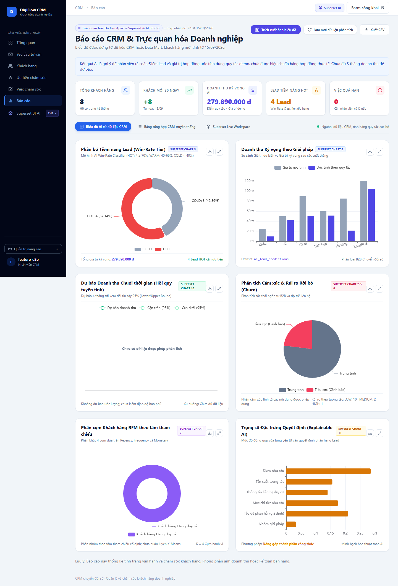

# Kiểm thử E2E và đánh giá AI — 15/10/2026

## Phạm vi và môi trường

Đợt kiểm tra thực hiện trên nhánh `codex/e2e-ai-quality-fixes`, với CRM Django/Wagtail, SQLite test cô lập, PostgreSQL 16 và Superset 6.0.0 đang chạy local. Browser dùng Chromium qua Playwright. Các thao tác browser có ghi dữ liệu chạy trong `StaticLiveServerTestCase`; database development chỉ được thêm 8 hồ sơ minh họa và chạy lại các bảng phân tích dẫn xuất theo yêu cầu. Không gửi email ra ngoài.

Đây là kiểm tra các luồng và trường hợp biên được liệt kê, không phải chứng minh mọi đầu vào có thể có đều không còn lỗi. Trạng thái kiểm tra cuối, số test và thời gian được lưu ở [test-results.json](validation/test-results.json).

## Ma trận kiểm thử

| Nhóm tính năng | Tình huống đã kiểm tra | Cách kiểm tra |
|---|---|---|
| Landing/CMS | Trang công khai, nội dung CMS đã publish, privacy, mở/đóng modal | Browser và Django test |
| Form tư vấn | Hợp lệ, email sai/trùng, thiếu consent, honeypot, chat bị xóa vẫn giữ lựa chọn sau lỗi form, consent AI tùy chọn | Browser và form/view test |
| Chat tư vấn | Nhiều lượt giữ ngữ cảnh, POS ánh xạ đúng lựa chọn Kho/POS, lỗi JSON/cấu trúc/history/độ dài, Gemini lỗi/timeout/rỗng, thông báo provider | Browser, regression và Gemini thật trên dữ liệu minh họa |
| Hồ sơ/AI | Phân khúc, lưu lịch sử, consent từng nội dung, chặn lead chưa consent, Gemini trả JSON sai, rủi ro trước VIP, khách hẹn lại quý sau | Browser, service/view test và 7 tình huống Gemini |
| Khách hàng/ưu tiên | Tìm kiếm/lọc/phân trang, lý do ưu tiên, CSV theo bộ lọc/chống công thức bảng tính | Browser và view test |
| Việc chăm sóc | Tạo từ đề xuất, sửa, quá hạn/hôm nay, hoàn tất, mở lại, gán người tạo và dấu thời gian hoàn tất | Browser và model/view test |
| Email nháp | 5 mục tiêu × 2 giọng văn × 3 độ dài, ngữ cảnh có consent, không gửi khi tạo nháp, chỉ ghi lịch sử khi xác nhận đã gửi | Browser, service test và Gemini thật |
| Follow-up | Nhân viên gửi bằng email backend trong bộ nhớ, form phản hồi một lần, thiếu consent, link sai/thu hồi/hết hạn, gửi lỗi và quyền staff | Browser và view/service test |
| Wagtail | Danh sách 6 snippet; tạo/sửa khách hàng; đăng ký viewset và publish landing page | Browser và Django test |
| Nhập/xuất dữ liệu | CSV dry-run, trùng email, update có chủ đích, dòng sai làm hủy cả lần nhập, CSV UTF-8 | Command và view test; không có màn hình nhập CSV |
| Báo cáo CRM | Dữ liệu rỗng, dữ liệu thật trong DB test, refresh POST có quyền, CSV/PNG, lightbox, desktop/mobile không tràn ngang | Browser và regression |
| Analytics | Đọc đúng amount, loại VOID, tháng không có giao dịch, ít dữ liệu, đổi năm, consent, lead hoàn tất và liên hệ mới không bị báo ngâm | Unit/regression trên SQLite và PostgreSQL |
| Superset/MCP | 10 dataset, 12 query biểu đồ, 2 dashboard có biểu đồ; stdio initialize/notification/tools/ping; role chỉ đọc và chặn bảng CRM gốc | API/browser Superset đang chạy, subprocess MCP và regression PostgreSQL |

## Các lỗi đã sửa

1. Pipeline dự báo chỉ lấy ngày nhưng đọc trường tiền không được truy vấn, làm doanh thu thành 0. Đã lấy đủ số tiền, điền tháng không có WON bằng 0, không dựng dự báo giả khi thiếu lịch sử.
2. Nút đồng bộ gọi phương thức không tồn tại và ghi dữ liệu bằng GET. Đã gọi `run_all()`, dùng POST/CSRF và quyền `analyze_customer`.
3. Chat JSON dạng list/null/kiểu sai hoặc history có phần tử sai có thể gây lỗi. Đã kiểm tra và giới hạn dữ liệu trước khi xử lý.
4. Chat cục bộ mất ngữ cảnh câu hỏi tiếp nối; mã POS không có trong lựa chọn form; từ “ai” có thể bị nhận diện trong từ khác. Đã giữ ngữ cảnh người hỏi, ánh xạ POS sang ERP/Kho-POS và dùng ranh giới từ.
5. Bản tư vấn cũ hứa giá, thời gian và bảo mật chưa được xác nhận. Đã sửa nội dung cục bộ và prompt; có timeout và fallback. Email nháp bị phát hiện hứa có gói phù hợp ngân sách trong một lần gọi thật; đã thêm kiểm tra cam kết chưa xác nhận và test hồi quy.
6. VIP/tiềm năng được chọn trước dấu hiệu hủy hoặc tạm dừng. Đã ưu tiên nguy cơ rời bỏ và hẹn lại; bổ sung tiêu chí không đồng nhất ngân sách chưa phê duyệt với tạm dừng.
7. Lexicon đếm từ tích cực bên trong câu phủ định và từ con. Đã xử lý cụm dài, ranh giới từ và phủ định thường gặp; vẫn có giới hạn với ngôn ngữ mỉa mai.
8. Pipeline/chat hồ sơ công khai có thể lấy nội dung chưa consent. Đã thêm `Interaction.ai_processing_consent`; lead, chat, phản hồi mới lưu đúng lựa chọn. Chat cũ chưa có bằng chứng consent được loại khỏi ngữ cảnh công khai.
9. Nút “Xóa” ngữ cảnh chat bị tự đính kèm trở lại khi submit hoặc reload sau lỗi. Đã giữ lựa chọn không đính kèm trong trạng thái hội thoại.
10. Form follow-up trên browser bị CSRF vì `no-referrer` làm Origin thành `null`. Đã dùng `strict-origin`, giữ origin cho kiểm tra CSRF và không gửi đường dẫn chứa token qua Referer.
11. Ba trang mobile tràn ngang: khách hàng, lead, ưu tiên. Đã sửa flex min-width, vùng bảng cuộn ngang, xuống dòng email và thêm hướng dẫn cuộn.
12. Báo cáo chèn số liệu mẫu như kết quả thật và đưa JSON không escape vào script. Đã bỏ dữ liệu mẫu/metric ghi cứng, dùng `json_script`, biểu đồ cục bộ và nhãn nguồn dữ liệu.
13. Độ dài email cục bộ không đổi và lời chào lấy họ thay vì cả tên. Đã sửa độ dài, lời chào và chỉ dùng ngữ cảnh có consent.
14. Hoàn tất việc qua Wagtail không đồng nhất dấu thời gian với frontend. Đã đưa quy tắc hoàn tất/mở lại vào model `save()`.
15. MCP không có initialize, in banner lên stdout, dùng quyền DB ứng dụng và giả dashboard publish khi offline. Đã sửa lifecycle stdio, lỗi rõ ràng và dùng `superset_ro` trong transaction chỉ đọc có timeout.
16. Bootstrap chart dùng chung bị gán mất dashboard thứ nhất; pipeline startup chạy trước khi seed. Đã sửa liên kết dashboard, thứ tự khởi tạo và tên phương pháp đúng với code.

## Dữ liệu tư vấn mới và kết quả

Tệp nguồn: [consultation_scenarios.json](../crm/data/consultation_scenarios.json). Mọi tên công ty, ngân sách, hội thoại và email `.test` đều do nhóm biên soạn, không phải hồ sơ khách hàng thật. Có 8 hồ sơ (7 cho phép AI, 1 từ chối), gồm CRM cho 12 sales, 3 kho/2 POS, sự cố backup, tích hợp API, hẹn quý sau, AI cần nhân viên duyệt, thiếu thông tin và không consent.

| Tình huống | Nhãn kỳ vọng | Nhãn lưu mới nhất | Điểm | Nguồn |
|---|---|---|---:|---|
| crm-sales | POTENTIAL | POTENTIAL | 75 | gemini |
| warehouse-pos | POTENTIAL | POTENTIAL | 75 | gemini |
| backup-incident | CHURN_RISK | CHURN_RISK | 10 | gemini |
| integration-api | POTENTIAL | POTENTIAL | 75 | gemini |
| deferred-budget | HIBERNATING | HIBERNATING | 20 | gemini |
| ai-assistant | POTENTIAL | POTENTIAL | 75 | gemini |
| insufficient | UNCLASSIFIED | UNCLASSIFIED | 10 | gemini |
| no-consent | Không phân tích | Không có AIAnalysis | — | Không gọi AI |

Kết quả 7/7 trên là lần chạy lại đủ 7 tình huống sau khi sửa prompt. Lần đầu CRM đang trình duyệt ngân sách bị Gemini xếp HIBERNATING, và một ca backup phải fallback; bằng chứng giữ tại [ai-quality-initial.json](validation/ai-quality-initial.json). Kết quả mới: [ai-quality-gemini.json](validation/ai-quality-gemini.json). Bộ ca có dùng để sửa prompt/rules, do đó **không phải tập kiểm định độc lập và không chứng minh độ chính xác 100% trên khách hàng thật**.

Hội thoại Gemini thật đã giữ ngữ cảnh 3 kho/2 POS khi khách hỏi tiếp về chi phí, và tạo email nháp bám theo 12 sales/4 bảng tính/ngân sách chờ duyệt. Xem [live-ai-conversation.json](validation/live-ai-conversation.json). Email chỉ là bản nháp, cần nhân viên rà soát; bộ kiểm tra câu cam kết không bảo đảm phát hiện mọi dạng bịa thông tin.

### Phân tích nghiệp vụ và hành động nên làm

Đây là đề xuất để nhân viên duyệt, chưa tự tạo việc hay liên hệ khách hàng:

| Hồ sơ | Căn cứ và hành động tiếp theo |
|---|---|
| Sao Mai — sự cố backup | Ưu tiên xử lý rủi ro trước bán hàng: xác minh bản sao, mức ảnh hưởng và khả năng khôi phục; giao đầu mối kỹ thuật rồi cập nhật khách. Không hứa khôi phục thành công hoặc thời hạn chưa xác nhận. |
| An Phúc — CRM cho 12 sales | Đang có nhu cầu cụ thể, ngân sách 30 triệu còn chờ duyệt. Xin mẫu cột của 4 bảng tính, xác nhận người phê duyệt và demo phát hiện trùng/giao việc. Chưa đủ căn cứ coi là hợp đồng sắp chốt. |
| Kho Sông Xanh — 3 kho/2 POS | Chọn một điểm thí điểm, kiểm tra máy quét/API và thống nhất cách đối chiếu tồn trước khi báo phạm vi. Đo sai lệch tồn và thời gian kiểm kê; chưa hứa đồng bộ thời gian thực. |
| Kết Nối Việt — API | Kiểm tra tài liệu và quyền sandbox, thống nhất mã định danh/chống trùng; thử một luồng tạo khách. Không mặc định phải thay phần mềm hiện hữu. |
| Bình An — hẹn quý sau | Tôn trọng yêu cầu tạm dừng; nhân viên xác nhận mốc liên hệ lại trong quý sau thay vì gửi báo giá thúc chốt. Điểm thấp ở đây không có nghĩa là khách phản đối sản phẩm. |
| Dịch vụ Mộc — AI | Dùng 200 tình huống ẩn danh để chia bộ phát triển/kiểm định riêng; đo tính đúng, mức sửa email và thời gian tiết kiệm. Luôn có bước duyệt trước khi gửi. |
| Hồ sơ mới — thiếu thông tin | Hỏi vấn đề cần giải quyết, quy mô và người phụ trách trước khi xếp ưu tiên bán hàng. Không suy diễn nhu cầu từ lời chào. |
| Riêng tư — không consent AI | Tiếp nhận và chăm sóc thủ công theo yêu cầu; không coi việc từ chối AI là từ chối tư vấn. Không đưa nội dung vào Gemini hoặc bảng phân tích AI. |

Các hồ sơ POTENTIAL cùng điểm 75 không đủ để phân thứ tự chốt bán. Cần thêm hạn cần giải pháp, người quyết định, mức sẵn sàng dữ liệu và kết quả khảo sát; xử lý sự cố Sao Mai là ưu tiên dịch vụ riêng dù điểm bán hàng thấp.

## Chất lượng các phương pháp

- **Sentiment:** 19/20 câu đúng nhãn, Accuracy 0,95 và Macro F1 xấp xỉ 0,9501 trên bộ nhỏ do nhóm biên soạn. Câu “Hài lòng gì mà ngày nào cũng lỗi.” còn bị nhận trung tính. Rules không hiểu ngôn ngữ mỉa mai/gián tiếp một cách tổng quát. Không dùng tỷ lệ này làm độ chính xác triển khai thực tế.
- **Ý định giải pháp:** 8/8 tình huống khớp nhóm kỳ vọng sau khi chỉnh thứ tự nhận diện; nội dung có nhiều nhu cầu vẫn cần nhân viên xác nhận.
- **Phân khúc:** rules và Gemini cùng khớp 7/7 nhãn kỳ vọng của bộ minh họa. Điểm Gemini là gợi ý không được hiệu chuẩn xác suất; không có dữ liệu nhãn WON/LOST để tính Accuracy chuyển đổi hay ROC-AUC.
- **RFM:** phân nhóm theo tâm tham chiếu cố định. Chưa chạy K-Means/Elbow, không có Silhouette hoặc Davies-Bouldin đã kiểm chứng.
- **Dự báo:** rolling-origin trên 4 tháng giao dịch demo cho MAE khoảng **4.431.953 VNĐ**, trong khi dự báo bằng doanh thu tháng trước có MAE **3.500.000 VNĐ**. Hồi quy hiện **kém baseline**, chưa đủ cơ sở dùng để lập kế hoạch doanh thu. Dải 95% là ước lượng từ residual, chưa đánh giá độ bao phủ trên dữ liệu độc lập.
- **Giải thích:** hiển thị đóng góp các thành phần công thức đang chạy, không phải SHAP/Shapley hay bằng chứng nhân quả.

## Giao diện và khả năng sử dụng

Đã kiểm tra CRM ở 1440×1000 và 390×844: các trang chính không còn tràn ngang; bảng dài cuộn trong vùng riêng. Có điều hướng nhanh trong hồ sơ, giữ lựa chọn xóa ngữ cảnh, thông báo provider, trạng thái thiếu dữ liệu, tải PNG và lightbox. Superset tải khi chủ động mở tab; cần đăng nhập Superset, chưa có SSO.



[Ảnh hồ sơ trên mobile](validation/crm-profile-mobile.png)

Theo kiểm tra giao diện và thao tác browser, các luồng chính sử dụng được. Trang hồ sơ/lead dài và Wagtail vẫn cần người dùng làm quen; kết luận “dễ dùng” hiện là đánh giá kỹ thuật, chưa có đo lường với nhân viên kinh doanh thực tế. Nên thử 3–5 người với tác vụ tìm khách, xác nhận AI và tạo việc, ghi nhận thời gian/lỗi thao tác trước khi kết luận usability.

## Migration, vận hành và giới hạn còn lại

- Migration `0009_interaction_ai_processing_consent` thêm field nullable, đã migrate local. Không xóa dữ liệu cũ; nội dung cũ chưa chứng minh consent không được tự cho phép AI.
- `seed_consultation_scenarios` chỉ thêm hồ sơ có email minh họa, không ghi đè hồ sơ thông thường. `--analyze` là thao tác người vận hành chủ động yêu cầu; không tự gửi thư.
- `setup_superset_analytics` và nút làm mới cập nhật dữ liệu dẫn xuất; bootstrap REST cập nhật chart/layout. Dùng lại bootstrap có thể khôi phục cấu hình chuẩn thay các chỉnh sửa chart thủ công.
- Chưa kiểm thử gửi SMTP đến người nhận thật. Email flow được kiểm tra bằng backend trong bộ nhớ để không gửi thư thử tới khách hàng.
- Chưa chạy tải lớn, kiểm thử xâm nhập toàn diện, browser Firefox/Safari hoặc nghiên cứu usability với người dùng thật.
- Prompt không bảo đảm Gemini tuân thủ hoàn toàn: [lần tư vấn trước](validation/live-ai-conversation-initial.json) đã nói chắc về đồng bộ thời gian thực và đề nghị tự sắp xếp chuyên viên khi hệ thống chưa có công cụ đặt lịch. Đã siết chỉ dẫn về phạm vi và hướng khách về form; [lượt chạy lại](validation/live-ai-conversation.json) đã nêu điều kiện khảo sát và hướng về form. Vẫn cần rà soát nội dung và bộ đánh giá độc lập rộng hơn.
- `npm audit` ghi nhận 5 high và 2 moderate ở toolchain Tailwind 3.4.19 và dependency; 0 critical. `npm audit fix` trong phạm vi tương thích chưa giải quyết hết. Không tự nâng Tailwind sang v4 vì dự án yêu cầu v3.4.19; đây là việc cần xử lý riêng trước triển khai, không được xem là đã hết cảnh báo bảo mật.

## Đối chiếu 6 yêu cầu TH2

| Yêu cầu | Kết luận sau kiểm thử |
|---|---|
| 1. Kiến trúc kết nối dữ liệu | Đã có CRM → PostgreSQL → analytics → Superset; chạy theo yêu cầu, chưa có đồng bộ nền. |
| 2. Mô hình phân tích AI | Có Gemini/rules, sentiment, scoring, RFM và dự báo; chất lượng chỉ được đo trên dữ liệu minh họa nhỏ, dự báo chưa vượt baseline. |
| 3. Superset MCP và biểu đồ | Kết nối, dashboard và MCP đọc dữ liệu đã chạy thật. **Một phần nếu yêu cầu tạo biểu đồ trực tiếp bằng MCP**: hiện biểu đồ được dựng qua REST bootstrap, MCP chưa có tool tạo chart. |
| 4. Kết quả AI trên dashboard | Đã hiển thị từ các bảng analytics; cần refresh pipeline sau khi dữ liệu CRM thay đổi. |
| 5. Báo cáo luồng và hiệu quả AI | Đã có báo cáo kỹ thuật, số đo tái lập, ca sai và bằng chứng; chưa có đánh giá trên khách hàng thực tế. |
| 6. Nhiều mô hình/phương pháp | Có nhiều phương pháp và hướng phát triển; cần gọi đúng tên phương pháp hiện thực, chưa thể khẳng định được cộng điểm. |

Về triển khai và demo, phần lớn yêu cầu đã có bằng chứng hoạt động. Nếu giảng viên yêu cầu dữ liệu khách hàng thật hoặc dựng chart thông qua MCP, hai phần này vẫn chưa đáp ứng đầy đủ; dữ liệu bổ sung trong đợt này là minh họa theo lựa chọn của người dùng.

## Các nhóm tệp thay đổi

- Dữ liệu/consent: `crm/models.py`, migration `0009`, `crm/forms.py`, `crm/data/consultation_scenarios.json`, command seed mới.
- AI: `crm/services/consultation.py`, `ai_service.py`, `ai_chat_service.py`, `email_draft_service.py`; `crm/analytics/{ai_engine,pipeline,evaluation}.py` và command đánh giá/chạy pipeline.
- Giao diện/vận hành: `crm/views.py`, `crm/context_processors.py`, template CRM, CSS/Tailwind, ECharts cục bộ, settings, `.env.example`, Docker startup/compose.
- BI/MCP: `superset/{mcp_server,bootstrap_superset}.py`, command MCP/setup analytics.
- Kiểm thử: `crm/test_quality_regressions.py`, `test_browser_e2e.py` và test AI/chat/email/follow-up; hai script kiểm tra live; workflow CI.
- Bàn giao: `README.md`, roadmap, báo cáo kỹ thuật, kịch bản demo, báo cáo này và JSON/ảnh trong `docs/validation/`.

## Lệnh tái lập

```powershell
python manage.py check
python manage.py makemigrations --check --dry-run
python manage.py test
$env:USE_SQLITE = "1"
$env:RUN_BROWSER_E2E = "1"
python manage.py test --verbosity=2
Remove-Item Env:RUN_BROWSER_E2E
Remove-Item Env:USE_SQLITE
python manage.py evaluate_ai_quality --output docs/validation/ai-quality-rules.json
python manage.py evaluate_ai_quality --provider stored --output docs/validation/ai-quality-gemini.json
python manage.py verify_superset_analytics
python manage.py run_superset_mcp --test
python scripts/verify_live_integrations.py --browser
cd tailwind
npm install
npm run css:build
```
